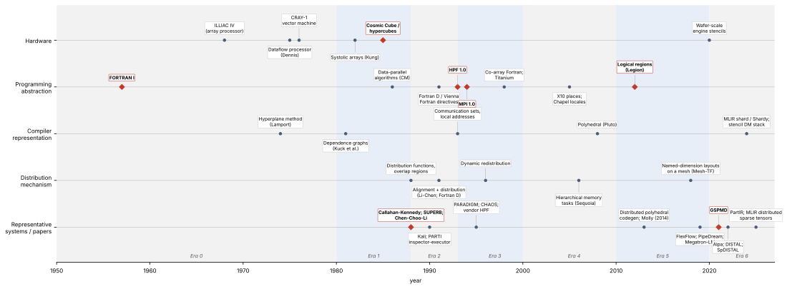
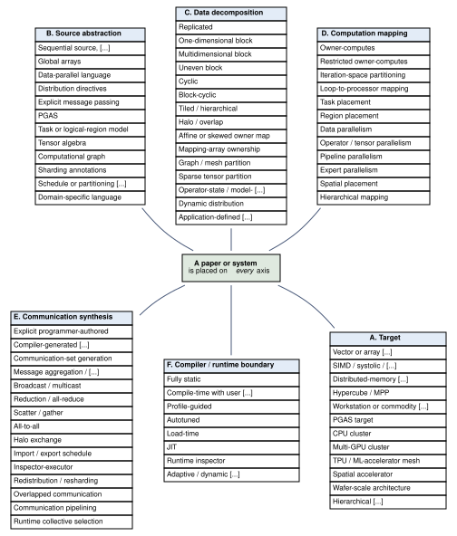
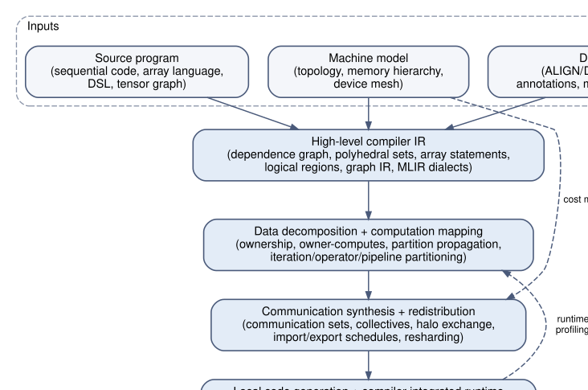
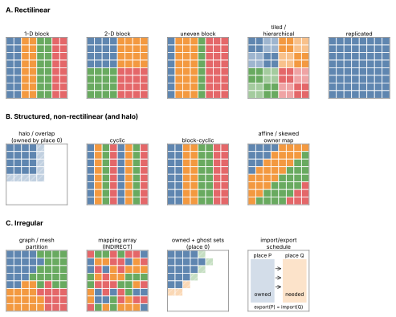
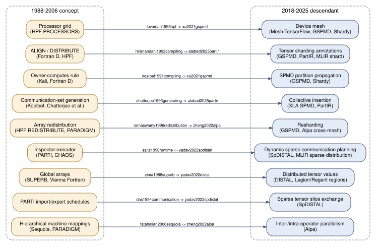

# Distributed-Memory Compilers: A Historical Survey and Taxonomy

**Working title of the companion paper:** *Compiling for Distributed Memory: A Historical Survey and Taxonomy from Global Arrays to Mesh-Sharded AI Systems*

This repository is the open, evidence-based knowledge base behind a survey of
**compilers for machines with physically distributed memories**: from the
compiler and parallel-machine foundations of the 1950s–70s, through Fortran D,
High Performance Fortran, PARTI/CHAOS and MPI in the 1990s, PGAS and task/region
systems in the 2000s–2010s, to today's SPMD partitioners (GSPMD, PartIR,
Shardy), distributed tensor compilers (DISTAL), MLIR distribution dialects, and
compilers for wafer-scale and spatial accelerators.  The central question is:

> How have compilers for machines with physically distributed memories
> represented, decomposed, mapped, communicated, optimized, and executed data
> and computation?

The catalog (`catalog/papers.yaml`), systems list, taxonomy, figures and the
IEEE manuscript are generated from the same source so that they cannot drift
apart.  Every entry records how its metadata was verified and which sections
of the primary source support its classification.  Entries that have not yet
been read beyond their bibliographic record say so.

## Status

<!-- BEGIN:status -->
| metric | value |
|---|---|
| papers in catalog | 98 |
| systems | 28 |
| metadata-verified against Crossref/arXiv | 90 |
| status `verified` (primary source read) | 4 |
| status `read` | 15 |
| status `screened` / `discovered` | 79 |
| tier core / bridge / foundation / adjacent | 71 / 11 / 11 / 5 |
| paper cards | 19 |
<!-- END:status -->

Status meanings: `discovered` = metadata verified against Crossref/arXiv
only; `screened` = abstract or official documentation checked; `read` =
enough of the primary source read to write a paper card; `verified` = card
and classification independently re-checked.  See `docs/methodology.md`.

## Timeline



Lanes: hardware, programming abstraction, compiler representation,
distribution mechanism, representative systems.  Diamonds mark era
transitions.  Every event is tied to a catalog entry (`catalog/timeline.yaml`).

## Start here

A reading path for a newcomer.  Each item names the concept you should take
away from it.  Links go to the DOI, arXiv or the official open copy.

<!-- BEGIN:start-here -->
**Foundational map**

1. [Compiling for distributed-memory systems](https://doi.org/10.1109/5.214550) — Zima and Chapman, 1993.  
   *Learn:* The 1993 state of the art in one place: what a distributed-memory compiler had to do for data distribution, work distribution and communication before HPF compilers existed.
2. [Compiling High Performance Fortran for distributed-memory architectures](https://doi.org/10.1016/s0167-8191(99)00074-5) — Benkner and Zima, 1999.  
   *Learn:* An end-of-decade overview of HPF compilation; read it after the 1993 overview to see what matured and what did not.

**Global arrays and owner-computes**

3. [Compiling programs for distributed-memory multiprocessors](https://doi.org/10.1007/bf00128175) — Callahan and Kennedy, 1988.  
   *Learn:* One of the three 1988 papers that first posed distribution and communication as compiler problems.
4. [Compiling global name-space parallel loops for distributed execution](https://doi.org/10.1109/71.97901) — Koelbel and Mehrotra, 1991.  
   *Learn:* How a compiler turns a global-name-space loop into local loops plus messages, statically when it can and at runtime when it cannot.
5. [Compiling Fortran D for MIMD distributed-memory machines](https://doi.org/10.1145/135226.135230) — Hiranandani et al., 1992.  
   *Learn:* The canonical description of the data-decomposition-plus-owner-computes compiler; the direct ancestor of HPF compilation.

**Automatic distribution**

6. [The data alignment phase in compiling programs for distributed-memory machines](https://doi.org/10.1016/0743-7315(91)90090-v) — Li and Chen, 1991.  
   *Learn:* Automatic alignment: the first half of automatic data distribution, separated from the choice of distribution itself.
7. [Compile-time techniques for data distribution in distributed memory machines](https://doi.org/10.1109/71.97903) — Ramanujam and Sadayappan, 1991.  
   *Learn:* Automatic distribution selection from dependences, the companion problem to alignment.
8. [The Paradigm compiler for distributed-memory multicomputers](https://doi.org/10.1109/2.467577) — Banerjee et al., 1995.  
   *Learn:* The most complete automatic (no-directive) distributed-memory compiler of the 1990s.

**Irregular computation**

9. [Run-time scheduling and execution of loops on message passing machines](https://doi.org/10.1016/0743-7315(90)90129-d) — Saltz et al., 1990.  
   *Learn:* It is the origin of the inspector/executor split for irregular loops, showing precisely what must be precomputed (communication pairing, local numbering, data reordering) before a distributed-memory irregular loop can run efficiently.

**MPI generation**

10. [Compiling affine loop nests for distributed-memory parallel architectures](https://doi.org/10.1145/2503210.2503289) — Bondhugula, 2013.  
   *Learn:* The reference modern polyhedral approach to automatic MPI generation.
11. [Introducing Molly: Distributed Memory Parallelization with LLVM](https://arxiv.org/abs/1409.2088) — Kruse, 2014.  
   *Learn:* Learn how array elements (not just iterations) can be modelled as polyhedral points with home-location and where-mapping functions, and how owner-computes plus dependence analysis yields communication inside an LLVM pass.

**Modern distributed tensors**

12. [GSPMD: General and Scalable Parallelization for ML Computation Graphs](https://arxiv.org/abs/2105.04663) — Xu et al., 2021.  
   *Learn:* Learn the replicated/tiled/partially-tiled sharding representation and priority-based sharding propagation that later systems (Alpa) reuse as their intra-operator mechanism.
13. [Alpa: Automating Inter- and Intra-Operator Parallelism for Distributed Deep Learning](https://arxiv.org/abs/2201.12023) — Zheng et al., 2022.  
   *Learn:* Learn the inter-/intra-operator hierarchy and how an ILP plus DP, backed by profiling and GSPMD-based compilation, can automatically derive combined data/operator/pipeline plans.
14. [PartIR: Composing SPMD Partitioning Strategies for Machine Learning](https://doi.org/10.1145/3669940.3707284) — Alabed et al., 2025.  
   *Learn:* Learn how distribution can be modelled as semantics-preserving program rewrites (loops plus slices over named mesh axes) instead of per-tensor layout annotations.
15. [DISTAL: the distributed tensor algebra compiler](https://doi.org/10.1145/3519939.3523437) — Yadav et al., 2022.  
   *Learn:* Learn how separating a data-distribution language from a loop-scheduling language lets one compiler express many distributed algorithms as schedules while delegating physical data movement to a runtime.
16. [A shared compilation stack for distributed-memory parallelism in stencil DSLs](https://doi.org/10.1145/3620666.3651344) — Bisbas et al., 2024.  
   *Learn:* Learn how domain decomposition and halo exchange can be made reusable compiler IR (SSA dialects) instead of per-DSL runtime code, and what MLIR currently lacks for distributed memory.
<!-- END:start-here -->

## Taxonomy



Papers and systems are classified on independent axes rather than on a single
chronological tree: target, programming abstraction, data decomposition,
computation mapping, communication synthesis, compiler/runtime boundary,
compiler architecture, optimization objective, maturity, paper type, and
compiler representation.  Definitions are in `catalog/taxonomy.yaml` and the
rationale in `docs/taxonomy.md`.







## Categories

<!-- BEGIN:categories -->
### Foundations (pre-1980 compiler, dependence, vector/array/dataflow machines)

- **Backus et al. (1957)** — [The FORTRAN automatic coding system](https://doi.org/10.1145/1455567.1455599) — *foundational*. *(metadata-verified; summary pending full read)*  
  Where the compiler bargain starts: a higher-level program in exchange for compiler-made low-level decisions.  
  `foundations`
- **Barnes et al. (1968)** — [The ILLIAC IV Computer](https://doi.org/10.1109/tc.1968.229158) — *hardware*. *(metadata-verified; summary pending full read)*  
  The canonical array processor; cited to anchor the SIMD/array lane of the timeline.  
  `foundations` `hardware`
- **Lamport (1974)** — [The parallel execution of DO loops](https://doi.org/10.1145/360827.360844) — *foundational*. *(metadata-verified; summary pending full read)*  
  The iteration-space view of loops that every later partitioner, polyhedral or otherwise, relies on.  
  `foundations` `dependence`
- **Dennis and Misunas (1975)** — [A preliminary architecture for a basic data-flow processor](https://doi.org/10.1145/642089.642111) — *hardware*. *(metadata-verified; summary pending full read)*  
  Dataflow execution with explicit token movement, an ancestor of spatial dataflow accelerators.  
  `foundations` `hardware` `dataflow`
- **Russell (1978)** — [The CRAY-1 computer system](https://doi.org/10.1145/359327.359336) — *hardware*. *(metadata-verified; summary pending full read)*  
  The canonical pipelined vector machine of the foundations era.  
  `foundations` `hardware`
- **Kuck et al. (1981)** — [Dependence graphs and compiler optimizations](https://doi.org/10.1145/567532.567555) — *foundational*. *(metadata-verified; summary pending full read)*  
  Dependence graphs are the representation Era-2 distributed-memory compilers inherited unchanged.  
  `foundations` `dependence`
- **Kung (1982)** — [Why systolic architectures?](https://doi.org/10.1109/mc.1982.1653825) — *hardware*. *(metadata-verified; summary pending full read)*  
  Systolic arrays are the closest architectural ancestor of today's wafer-scale and spatial compilation targets.  
  `foundations` `hardware` `systolic`
- **Seitz (1985)** — [The cosmic cube](https://doi.org/10.1145/2465.2467) — *hardware*. *(metadata-verified; summary pending full read)*  
  The machine that made distributed memory the programmer's, and soon the compiler's, problem.  
  `foundations` `hardware` `hypercube`
- **Hillis and Steele (1986)** — [Data parallel algorithms](https://doi.org/10.1145/7902.7903) — *foundational*. *(metadata-verified; summary pending full read)*  
  The data-parallel programming model that HPF's array statements and today's SPMD tensor programs both descend from.  
  `foundations` `data-parallel`
- **Allen and Kennedy (1987)** — [Automatic translation of FORTRAN programs to vector form](https://doi.org/10.1145/29873.29875) — *foundational*. *(metadata-verified; summary pending full read)*  
  The dependence-based vectoriser from which the Rice Fortran D work grew.  
  `foundations` `vectorization`

### Global arrays and pre-HPF systems

- **Callahan and Kennedy (1988)** — [Compiling programs for distributed-memory multiprocessors](https://doi.org/10.1007/bf00128175) — *compiler-technique*. *(metadata-verified; summary pending full read)*  
  One of the three 1988 papers that first posed distribution and communication as compiler problems.  
  `global-arrays` `owner-computes`
- **Zima et al. (1988)** — [SUPERB: A tool for semi-automatic MIMD/SIMD parallelization](https://doi.org/10.1016/0167-8191(88)90002-6) — *full-system*. *(metadata-verified; summary pending full read)*  
  The first full tool for semi-automatic distributed-memory parallelisation; introduces the interactive restructuring approach.  
  `global-arrays` `superb`
- **Chen et al. (1988)** — [Compiling parallel programs by optimizing performance](https://doi.org/10.1007/bf00128176) — *compiler-technique*. *(metadata-verified; summary pending full read)*  
  Introduces performance-model-driven compilation, the ancestor of cost-model-based partition search.  
  `performance-model` `alignment`
- **Gerndt (1990)** — [Updating distributed variables in local computations](https://doi.org/10.1002/cpe.4330020303) — *compiler-technique*. *(metadata-verified; summary pending full read)*  
  The overlap/halo concept as the SUPERB compiler implemented it.  
  `superb` `halo`
- **Mehrotra and Rosendale (1990)** — [Programming distributed memory architectures using Kali](https://ntrs.nasa.gov/citations/19910002904) — *language*.  
  Learn the original inspector/executor idea for irregular loops together with the on-clause/owner() way of binding loop iterations to processors.  
  `global-arrays` `kali`
- **Koelbel and Mehrotra (1991)** — [Compiling global name-space parallel loops for distributed execution](https://doi.org/10.1109/71.97901) — *compiler-technique*. *(metadata-verified; summary pending full read)*  
  How a compiler turns a global-name-space loop into local loops plus messages, statically when it can and at runtime when it cannot.  
  `global-arrays` `kali` `owner-computes`
- **Koelbel and Mehrotra (1991)** — [Programming data parallel algorithms on distributed memory using Kali](https://doi.org/10.1145/109025.109122) — *language*. *(metadata-verified; summary pending full read)*  
  Kali from the programmer's side, with examples of regular and irregular algorithms.  
  `global-arrays` `kali`
- **Chapman et al. (1991)** — [Vienna Fortran: A Fortran language extension for distributed memory multiprocessors](https://ntrs.nasa.gov/citations/19920002452) — *language*.  
  Learn the declaration-level vocabulary for static vs dynamic distributions, alignment, connect sets and redistribution at procedure boundaries that fed into HPF.  
  `global-arrays` `vienna-fortran`
- **Li and Chen (1991)** — [The data alignment phase in compiling programs for distributed-memory machines](https://doi.org/10.1016/0743-7315(91)90090-v) — *compiler-technique*. *(metadata-verified; summary pending full read)*  
  Automatic alignment: the first half of automatic data distribution, separated from the choice of distribution itself.  
  `alignment` `automatic-distribution`
- **Ramanujam and Sadayappan (1991)** — [Compile-time techniques for data distribution in distributed memory machines](https://doi.org/10.1109/71.97903) — *compiler-technique*. *(metadata-verified; summary pending full read)*  
  Automatic distribution selection from dependences, the companion problem to alignment.  
  `automatic-distribution`
- **Koelbel (1991)** — [Compile-time generation of regular communications patterns](https://doi.org/10.1145/125826.125890) — *compiler-technique*. *(metadata-verified; summary pending full read)*  
  Closed-form communication generation for regular references, the opposite pole from inspector-executor.  
  `communication-generation` `kali`
- **Chapman et al. (1992)** — [Programming in Vienna Fortran](https://doi.org/10.1155/1992/258136) — *language*.  
  Learn how a data-distribution language exposes FORALL placement (explicit processor, owner of a datum, or compiler-chosen) and reductions on top of declarative distributions, and what a 1992 compiler actually implemented.  
  `global-arrays` `vienna-fortran`
- **Gupta and Banerjee (1992)** — [Demonstration of automatic data partitioning techniques for parallelizing compilers on multicomputers](https://doi.org/10.1109/71.127259) — *compiler-technique*. *(metadata-verified; summary pending full read)*  
  Automatic partitioning with a cost model, the basis of PARADIGM's distribution selection.  
  `automatic-distribution` `paradigm`
- **Su et al. (1993)** — [Automating Parallelism of Regular Computations for Distributed-Memory Multicomputers in the PARADIGM Compiler](https://doi.org/10.1109/icpp.1993.51) — *compiler-technique*. *(metadata-verified; summary pending full read)*  
  PARADIGM's regular-computation path before the full-system paper.  
  `paradigm` `automatic-distribution`
- **Anderson and Lam (1993)** — [Global optimizations for parallelism and locality on scalable parallel machines](https://doi.org/10.1145/155090.155101) — *compiler-technique*. *(metadata-verified; summary pending full read)*  
  Joint affine decomposition of data and computation, a precursor of polyhedral distributed-memory compilation.  
  `automatic-distribution` `affine`
- **Rogers and Pingali (1994)** — [Compiling for distributed memory architectures](https://doi.org/10.1109/71.277789) — *full-system*. *(metadata-verified; summary pending full read)*  
  A non-Fortran, functional-language take on the same distribution and communication problems.  
  `communication-generation`
- **Banerjee et al. (1995)** — [The Paradigm compiler for distributed-memory multicomputers](https://doi.org/10.1109/2.467577) — *full-system*. *(metadata-verified; summary pending full read)*  
  The most complete automatic (no-directive) distributed-memory compiler of the 1990s.  
  `paradigm` `automatic-distribution`
- **Lee (1995)** — [Techniques for compiling programs on distributed memory multicomputers](https://doi.org/10.1016/0167-8191(95)00052-6) — *compiler-technique*. *(metadata-verified; summary pending full read)*  
  Representative mid-1990s technique paper; also the example used in the methodology for why titles can mislead about paper type.  
  `communication-generation`
- **Palermo et al. (1996)** — [Dynamic Data Partitioning for Distributed-Memory Multicomputers](https://doi.org/10.1006/jpdc.1996.0138) — *compiler-technique*. *(metadata-verified; summary pending full read)*  
  Phase-wise distribution selection, the 1990s form of what ML compilers now call cross-stage resharding.  
  `paradigm` `redistribution`
- **Ramaswamy et al. (1996)** — [Optimizations for Efficient Array Redistribution on Distributed Memory Multicomputers](https://doi.org/10.1006/jpdc.1996.0142) — *compiler-technique*. *(metadata-verified; summary pending full read)*  
  The redistribution problem in its HPF form.  
  `paradigm` `redistribution`

### Fortran D / HPF

- **Hiranandani et al. (1991)** — [Compiler optimizations for Fortran D on MIMD distributed-memory machines](https://doi.org/10.1145/125826.125886) — *compiler-technique*. *(metadata-verified; summary pending full read)*  
  The optimisation catalogue of the Fortran D compiler.  
  `fortran-d` `communication-generation`
- **Hiranandani et al. (1992)** — [Compiling Fortran D for MIMD distributed-memory machines](https://doi.org/10.1145/135226.135230) — *full-system*. *(metadata-verified; summary pending full read)*  
  The canonical description of the data-decomposition-plus-owner-computes compiler; the direct ancestor of HPF compilation.  
  `fortran-d` `owner-computes`
- **Hiranandani et al. (1992)** — [Evaluation of compiler optimizations for Fortran D on MIMD distributed memory machines](https://doi.org/10.1145/143369.143372) — *experience*. *(metadata-verified; summary pending full read)*  
  Measured effect of each Fortran D optimisation; the first systematic evaluation methodology for this class of compiler.  
  `fortran-d` `evaluation`
- **Loveman (1993)** — [High performance Fortran](https://doi.org/10.1109/88.219857) — *language*. *(metadata-verified; summary pending full read)*  
  The HPF language in one article; the directive set every later sharding annotation can be compared with.  
  `hpf` `language`
- **Forum (1993)** — [High Performance Fortran language specification](https://doi.org/10.1145/174223.158909) — *specification*. *(metadata-verified; summary pending full read)*  
  The normative definition of the distribution directives; cite it, not a secondary source, for what HPF 1.0 could express.  
  `hpf` `specification`
- **Bozkus et al. (1993)** — [Fortran 90D/HPF compiler for distributed memory MIMD computers](https://doi.org/10.1145/169627.169750) — *full-system*. *(metadata-verified; summary pending full read)*  
  An HPF-style compiler built around a runtime library of collective operations rather than compiler-synthesised messages.  
  `hpf` `fortran-90d`
- **Chatterjee et al. (1993)** — [Generating local addresses and communication sets for data-parallel programs](https://doi.org/10.1145/155332.155348) — *compiler-technique*. *(metadata-verified; summary pending full read)*  
  The address-arithmetic core of every HPF compiler: how a processor knows which of its local elements participate and whom to talk to.  
  `communication-generation` `block-cyclic`
- **Stichnoth et al. (1994)** — [Generating Communication for Array Statements: Design, Implementation, and Evaluation](https://doi.org/10.1006/jpdc.1994.1048) — *compiler-technique*. *(metadata-verified; summary pending full read)*  
  Array-statement communication generation evaluated inside a production research compiler.  
  `communication-generation` `fx`
- **Harris et al. (1995)** — [Compiling High Performance Fortran for Distributed-Memory Systems](https://ftp.math.utah.edu/pub/tex/bib/idx/dectechj/7/3/5_23.html) — *full-system*.  
  It is a concise, production-oriented description of how a commercial HPF compiler represents distributions and iteration spaces and derives static communication for block/cyclic data, including why strict owner-computes was not adopted.  
  `hpf` `production-compiler`
- **Gupta et al. (1995)** — [An HPF compiler for the IBM SP2](https://doi.org/10.1145/224170.224422) — *full-system*. *(metadata-verified; summary pending full read)*  
  A second production HPF compiler, for comparison with Digital's.  
  `hpf` `production-compiler`
- **Ancourt et al. (1995)** — [A Linear Algebra Framework for Static High Performance Fortran Code Distribution](https://doi.org/10.1155/1997/195689) — *compiler-technique*. *(metadata-verified; summary pending full read)*  
  The clearest link between HPF directives and the polyhedral formulation used two decades later.  
  `hpf` `polyhedral`
- **Benkner and Zima (1999)** — [Compiling High Performance Fortran for distributed-memory architectures](https://doi.org/10.1016/s0167-8191(99)00074-5) — *survey*. *(metadata-verified; summary pending full read)*  
  An end-of-decade overview of HPF compilation; read it after the 1993 overview to see what matured and what did not.  
  `survey` `hpf`
- **Kennedy et al. (2007)** — [The rise and fall of High Performance Fortran](https://doi.org/10.1145/1238844.1238851) — *experience*. *(metadata-verified; summary pending full read)*  
  The participants' own account of why the most ambitious distributed-memory compiler project of the 1990s faded; essential context for the cross-era synthesis.  
  `hpf` `history`

### MPI and generated message passing

- **Forum (1994)** — [MPI: A Message-Passing Interface Standard (Version 1.0)](https://www.mpi-forum.org/docs/) — *specification*. *(metadata-verified; summary pending full read)*  
  What 'explicit message passing' means in practice and what compilers from Fortran D onward generate.  
  `mpi` `specification`
- **Gropp et al. (1996)** — [A high-performance, portable implementation of the MPI message passing interface standard](https://doi.org/10.1016/0167-8191(96)00024-5) — *runtime*. *(metadata-verified; summary pending full read)*  
  Why MPI became portable and ubiquitous, which is half the explanation of why HPF lost.  
  `mpi` `runtime`
- **Bondhugula (2011)** — [Automatic Distributed-Memory Parallelization and Code Generation using the Polyhedral Framework](https://www.csa.iisc.ac.in/~udayb/publications/uday11distmem-tr.pdf) — *compiler-technique*.  
  Learn the flow-out/write-out set formulation of communication from exact dependences and how symbolic process counts are handled by generating runtime helper functions rather than virtual processors.  
  `polyhedral` `automatic-mpi`
- **Bondhugula (2013)** — [Compiling affine loop nests for distributed-memory parallel architectures](https://doi.org/10.1145/2503210.2503289) — *compiler-technique*. *(metadata-verified; summary pending full read)*  
  The reference modern polyhedral approach to automatic MPI generation.  
  `polyhedral` `automatic-mpi`
- **Kruse (2014)** — [Introducing Molly: Distributed Memory Parallelization with LLVM](https://arxiv.org/abs/1409.2088) — *full-system*.  
  Learn how array elements (not just iterations) can be modelled as polyhedral points with home-location and where-mapping functions, and how owner-computes plus dependence analysis yields communication inside an LLVM pass.  
  `polyhedral` `llvm` `automatic-mpi`
- **Bisbas et al. (2024)** — [A shared compilation stack for distributed-memory parallelism in stencil DSLs](https://doi.org/10.1145/3620666.3651344) — *full-system*.  
  Learn how domain decomposition and halo exchange can be made reusable compiler IR (SSA dialects) instead of per-DSL runtime code, and what MLIR currently lacks for distributed memory.  
  `mlir` `stencil` `automatic-mpi`

### Irregular computation / inspector-executor

- **Saltz et al. (1990)** — [Run-time scheduling and execution of loops on message passing machines](https://doi.org/10.1016/0743-7315(90)90129-d) — *runtime*.  
  It is the origin of the inspector/executor split for irregular loops, showing precisely what must be precomputed (communication pairing, local numbering, data reordering) before a distributed-memory irregular loop can run efficiently.  
  `irregular` `inspector-executor` `parti`
- **Saltz et al. (1991)** — [Multiprocessors and run‐time compilation](https://doi.org/10.1002/cpe.4330030607) — *runtime*.  
  It is where the inspector/executor terminology, the hashed cache, the distributed translation table and the first compiler (ARF) for irregularly distributed arrays are described together, and it situates PARTI relative to Kali, Crystal, DIME and Fortran-style compilers.  
  `irregular` `inspector-executor` `parti`
- **Das et al. (1991)** — [Distributed memory compiler methods for irregular problems: data copy reuse and runtime partitioning](https://ntrs.nasa.gov/citations/19920002451) — *runtime*.  
  It defines the PARTI primitive set (translation tables, schedules, gather/scatter/accumulate, buffer-after-owned-data layout) in enough detail to understand how later irregular-application compilers treat communication as reusable schedule objects.  
  `irregular` `parti`
- **Ponnusamy et al. (1993)** — [Runtime compilation techniques for data partitioning and communication schedule reuse](https://doi.org/10.1145/169627.169752) — *runtime*. *(metadata-verified; summary pending full read)*  
  Schedule reuse, the optimisation that makes inspector-executor affordable across time steps.  
  `irregular` `chaos`
- **Bik and Wijshoff (1993)** — [Compilation techniques for sparse matrix computations](https://doi.org/10.1145/165939.166023) — *compiler-technique*. *(metadata-verified; summary pending full read)*  
  Sparse compilation before distribution; useful background for SpDISTAL and MLIR sparse.  
  `sparse`
- **Das et al. (1994)** — [Communication Optimizations for Irregular Scientific Computations on Distributed Memory Architectures](https://doi.org/10.1006/jpdc.1994.1104) — *runtime*. *(metadata-verified; summary pending full read)*  
  The mature PARTI/CHAOS communication optimisations for unstructured meshes.  
  `irregular` `chaos`
- **Ponnusamy et al. (1995)** — [Runtime support and compilation methods for user-specified irregular data distributions](https://doi.org/10.1109/71.406958) — *runtime*. *(metadata-verified; summary pending full read)*  
  How irregular (mapping-array) distributions were integrated into a directive-based compiler.  
  `irregular` `chaos` `mapping-array`
- **Hwang et al. (1995)** — [Runtime and language support for compiling adaptive irregular programs on distributed‐memory machines](https://doi.org/10.1002/spe.4380250603) — *runtime*. *(metadata-verified; summary pending full read)*  
  Adaptive irregular programs: what breaks when the mesh changes and how CHAOS handled it.  
  `irregular` `chaos`
- **Ravishankar et al. (2015)** — [Distributed memory code generation for mixed Irregular/Regular computations](https://doi.org/10.1145/2688500.2688515) — *compiler-technique*. *(metadata-verified; summary pending full read)*  
  Where polyhedral code generation and inspector-executor meet.  
  `polyhedral` `irregular` `inspector-executor`
- **Yadav et al. (2022)** — [SpDISTAL: Compiling Distributed Sparse Tensor Computations](https://doi.org/10.1109/sc41404.2022.00064) — *full-system*.  
  Learn how sparse ownership and communication sets can be expressed as partitions derived from index structures (image/preimage) instead of explicit messages, with load balance controlled by non-zero versus universe partitioning.  
  `tensor-compilers` `sparse` `distal`
- **Vaidya et al. (2025)** — [Distributed Sparse Tensor Computations in MLIR](https://doi.org/10.1145/3731599.3767484) — *compiler-technique*. *(metadata-verified; summary pending full read)*  
  Distributed sparse tensors expressed in MLIR, the newest point on the inspector-executor lineage.  
  `mlir` `sparse` `tensor-compilers`

### PGAS and language systems

- **Numrich and Reid (1998)** — [Co-array Fortran for parallel programming](https://doi.org/10.1145/289918.289920) — *language*. *(metadata-verified; summary pending full read)*  
  The minimal PGAS idea: distribution as an extra array dimension indexed by processor.  
  `pgas` `caf`
- **Yelick et al. (1998)** — [Titanium: a high-performance Java dialect](https://doi.org/10.1002/(sici)1096-9128(199809/11)10:11/13<825::aid-cpe383>3.0.co;2-h) — *language*. *(metadata-verified; summary pending full read)*  
  PGAS in a safe language; Titanium's later compiler work is a lateral-snowball target.  
  `pgas` `titanium`
- **Chen et al. (2003)** — [A performance analysis of the Berkeley UPC compiler](https://doi.org/10.1145/782814.782825) — *full-system*. *(metadata-verified; summary pending full read)*  
  How a PGAS compiler is built and where its overheads come from.  
  `pgas` `upc`
- **Charles et al. (2005)** — [X10: an object-oriented approach to non-uniform cluster computing](https://doi.org/10.1145/1094811.1094852) — *language*. *(metadata-verified; summary pending full read)*  
  Places as a first-class language concept; the terminology this survey adopts for 'place'.  
  `pgas` `x10`
- **Chamberlain et al. (2007)** — [Parallel Programmability and the Chapel Language](https://doi.org/10.1177/1094342007078442) — *language*. *(metadata-verified; summary pending full read)*  
  Global-view programming with user-definable distributions, the HPCS-era answer to HPF's fixed distribution set.  
  `pgas` `chapel`

### Polyhedral and affine distributed compilation

- **Anderson and Lam (1993)** — [Global optimizations for parallelism and locality on scalable parallel machines](https://doi.org/10.1145/155090.155101) — *compiler-technique*. *(metadata-verified; summary pending full read)*  
  Joint affine decomposition of data and computation, a precursor of polyhedral distributed-memory compilation.  
  `automatic-distribution` `affine`
- **Amarasinghe and Lam (1993)** — [Communication optimization and code generation for distributed memory machines](https://doi.org/10.1145/155090.155102) — *compiler-technique*. *(metadata-verified; summary pending full read)*  
  Exact dataflow-based communication generation for affine loops, bridging HPF-era compilers and the polyhedral era.  
  `communication-generation` `affine`
- **Ancourt et al. (1995)** — [A Linear Algebra Framework for Static High Performance Fortran Code Distribution](https://doi.org/10.1155/1997/195689) — *compiler-technique*. *(metadata-verified; summary pending full read)*  
  The clearest link between HPF directives and the polyhedral formulation used two decades later.  
  `hpf` `polyhedral`
- **Tang and Xue (2000)** — [Generating efficient tiled code for distributed memory machines](https://doi.org/10.1016/s0167-8191(00)00040-5) — *compiler-technique*. *(metadata-verified; summary pending full read)*  
  Tiling-based distributed code generation between the HPF era and the polyhedral revival.  
  `tiling` `affine`
- **Baskaran et al. (2008)** — [Automatic data movement and computation mapping for multi-level parallel architectures with explicitly managed memories](https://doi.org/10.1145/1345206.1345210) — *compiler-technique*. *(metadata-verified; summary pending full read)*  
  Polyhedral data-movement generation for explicitly managed memories, one step before distributed memory.  
  `polyhedral` `explicit-memory`
- **Bondhugula et al. (2008)** — [A practical automatic polyhedral parallelizer and locality optimizer](https://doi.org/10.1145/1375581.1375595) — *full-system*. *(metadata-verified; summary pending full read)*  
  The polyhedral transformation framework that the 2011-2016 distributed-memory code generators plug into.  
  `polyhedral` `pluto`
- **Bondhugula (2011)** — [Automatic Distributed-Memory Parallelization and Code Generation using the Polyhedral Framework](https://www.csa.iisc.ac.in/~udayb/publications/uday11distmem-tr.pdf) — *compiler-technique*.  
  Learn the flow-out/write-out set formulation of communication from exact dependences and how symbolic process counts are handled by generating runtime helper functions rather than virtual processors.  
  `polyhedral` `automatic-mpi`
- **Bondhugula (2013)** — [Compiling affine loop nests for distributed-memory parallel architectures](https://doi.org/10.1145/2503210.2503289) — *compiler-technique*. *(metadata-verified; summary pending full read)*  
  The reference modern polyhedral approach to automatic MPI generation.  
  `polyhedral` `automatic-mpi`
- **Kruse (2014)** — [Introducing Molly: Distributed Memory Parallelization with LLVM](https://arxiv.org/abs/1409.2088) — *full-system*.  
  Learn how array elements (not just iterations) can be modelled as polyhedral points with home-location and where-mapping functions, and how owner-computes plus dependence analysis yields communication inside an LLVM pass.  
  `polyhedral` `llvm` `automatic-mpi`
- **Ravishankar et al. (2015)** — [Distributed memory code generation for mixed Irregular/Regular computations](https://doi.org/10.1145/2688500.2688515) — *compiler-technique*. *(metadata-verified; summary pending full read)*  
  Where polyhedral code generation and inspector-executor meet.  
  `polyhedral` `irregular` `inspector-executor`
- **Dathathri et al. (2016)** — [Compiling Affine Loop Nests for a Dynamic Scheduling Runtime on Shared and Distributed Memory](https://doi.org/10.1145/2948975) — *compiler-technique*. *(metadata-verified; summary pending full read)*  
  Polyhedral analysis feeding a dynamic task runtime, an explicit move of the compiler/runtime boundary.  
  `polyhedral` `runtime`
- **Baghdadi et al. (2019)** — [Tiramisu: A Polyhedral Compiler for Expressing Fast and Portable Code](https://doi.org/10.1109/cgo.2019.8661197) — *full-system*. *(metadata-verified; summary pending full read)*  
  A scheduling-language compiler whose schedule can place computations on distributed nodes.  
  `polyhedral` `scheduling-languages`
- **Thangamani et al. (2024)** — [A Survey of General-purpose Polyhedral Compilers](https://doi.org/10.1145/3674735) — *survey*. *(metadata-verified; summary pending full read)*  
  Background for the polyhedral representation on which Bondhugula's and Molly's distributed-memory code generation rests.  
  `survey` `polyhedral`

### Task / region compiler systems

- **Fatahalian et al. (2006)** — [Sequoia: Programming the Memory Hierarchy](https://doi.org/10.1109/sc.2006.55) — *language*. *(metadata-verified; summary pending full read)*  
  Hierarchical memory as the programming abstraction; the ancestor of hierarchical mapping in Legion and Alpa.  
  `hierarchical` `sequoia`
- **Bauer et al. (2012)** — [Legion: Expressing locality and independence with logical regions](https://doi.org/10.1109/sc.2012.71) — *runtime*. *(metadata-verified; summary pending full read)*  
  Logical regions and mappers: the task-based alternative to compiler-chosen distribution.  
  `task-region` `legion`
- **Slaughter et al. (2015)** — [Regent: a high-productivity programming language for HPC with logical regions](https://doi.org/10.1145/2807591.2807629) — *language*. *(metadata-verified; summary pending full read)*  
  The compiler half of Legion: what can be decided statically about regions and tasks.  
  `task-region` `regent`
- **Yadav et al. (2022)** — [DISTAL: the distributed tensor algebra compiler](https://doi.org/10.1145/3519939.3523437) — *full-system*.  
  Learn how separating a data-distribution language from a loop-scheduling language lets one compiler express many distributed algorithms as schedules while delegating physical data movement to a runtime.  
  `tensor-compilers` `distal`

### Multi-GPU and ML compilers

- **Shazeer et al. (2018)** — [Mesh-TensorFlow: Deep Learning for Supercomputers](https://arxiv.org/abs/1811.02084) — *full-system*.  
  Learn the named-dimension plus mesh computation-layout abstraction that underlies later per-dimension sharding systems and the analytic communication/computation cost table for data, model and mixed layouts.  
  `ml-compilers` `mesh-sharding`
- **Huang et al. (2018)** — [GPipe: Efficient Training of Giant Neural Networks using Pipeline Parallelism](https://arxiv.org/abs/1811.06965) — *runtime*. *(metadata-verified; summary pending full read)*  
  Pipeline parallelism as a training-system mechanism; the baseline that Alpa's inter-operator pass automates.  
  `ml-systems` `pipeline`
- **Jia et al. (2019)** — [Beyond Data and Model Parallelism for Deep Neural Networks](https://arxiv.org/abs/1807.05358) — *full-system*.  
  Learn how a profiled, incremental execution simulator can replace on-hardware measurement as the cost oracle for randomized search over per-operator parallelization configurations.  
  `ml-compilers` `auto-parallel`
- **Narayanan et al. (2019)** — [PipeDream: generalized pipeline parallelism for DNN training](https://doi.org/10.1145/3341301.3359646) — *runtime*. *(metadata-verified; summary pending full read)*  
  Automatic stage partitioning for pipelines from profiled costs.  
  `ml-systems` `pipeline`
- **Shoeybi et al. (2019)** — [Megatron-LM: Training Multi-Billion Parameter Language Models Using Model Parallelism](https://arxiv.org/abs/1909.08053) — *runtime*. *(metadata-verified; summary pending full read)*  
  The hand-written tensor-parallel baseline that automatic partitioners compare against.  
  `ml-systems` `tensor-parallel`
- **Wang et al. (2019)** — [Supporting Very Large Models using Automatic Dataflow Graph Partitioning](https://doi.org/10.1145/3302424.3303953) — *full-system*. *(metadata-verified; summary pending full read)*  
  Automatic operator partitioning from operator semantics, a precursor of propagation-based partitioners.  
  `ml-compilers` `auto-parallel`
- **Rajbhandari et al. (2020)** — [ZeRO: Memory optimizations Toward Training Trillion Parameter Models](https://doi.org/10.1109/sc41405.2020.00024) — *runtime*. *(metadata-verified; summary pending full read)*  
  Model-state sharding, the memory-capacity objective that dominates Era 6.  
  `ml-systems` `memory`
- **Lepikhin et al. (2020)** — [GShard: Scaling Giant Models with Conditional Computation and Automatic Sharding](https://arxiv.org/abs/2006.16668) — *full-system*. *(metadata-verified; summary pending full read)*  
  Where XLA's annotate-and-propagate sharding model first appeared.  
  `ml-compilers` `mesh-sharding`
- **Xu et al. (2021)** — [GSPMD: General and Scalable Parallelization for ML Computation Graphs](https://arxiv.org/abs/2105.04663) — *full-system*.  
  Learn the replicated/tiled/partially-tiled sharding representation and priority-based sharding propagation that later systems (Alpa) reuse as their intra-operator mechanism.  
  `ml-compilers` `mesh-sharding` `spmd`
- **Zheng et al. (2022)** — [Alpa: Automating Inter- and Intra-Operator Parallelism for Distributed Deep Learning](https://arxiv.org/abs/2201.12023) — *full-system*.  
  Learn the inter-/intra-operator hierarchy and how an ILP plus DP, backed by profiling and GSPMD-based compilation, can automatically derive combined data/operator/pipeline plans.  
  `ml-compilers` `auto-parallel` `mesh-sharding`
- **Yadav et al. (2022)** — [DISTAL: the distributed tensor algebra compiler](https://doi.org/10.1145/3519939.3523437) — *full-system*.  
  Learn how separating a data-distribution language from a loop-scheduling language lets one compiler express many distributed algorithms as schedules while delegating physical data movement to a runtime.  
  `tensor-compilers` `distal`
- **Yadav et al. (2022)** — [SpDISTAL: Compiling Distributed Sparse Tensor Computations](https://doi.org/10.1109/sc41404.2022.00064) — *full-system*.  
  Learn how sparse ownership and communication sets can be expressed as partitions derived from index structures (image/preimage) instead of explicit messages, with load balance controlled by non-zero versus universe partitioning.  
  `tensor-compilers` `sparse` `distal`
- **Kong et al. (2023)** — [Automatic Generation of Distributed-Memory Mappings for Tensor Computations](https://doi.org/10.1145/3581784.3607096) — *compiler-technique*. *(metadata-verified; summary pending full read)*  
  Automatic distribution selection for tensor computations, revisiting the 1991 problem with modern cost models.  
  `tensor-compilers` `automatic-distribution`
- **Project (2024)** — [Shardy: an MLIR-based tensor partitioning system (official documentation)](https://openxla.org/shardy) — *specification*. *(metadata-verified; summary pending full read)*  
  The current production sharding IR in the XLA ecosystem; read the dialect reference after GSPMD and PartIR.  
  `ml-compilers` `mlir` `mesh-sharding`
- **Alabed et al. (2025)** — [PartIR: Composing SPMD Partitioning Strategies for Machine Learning](https://doi.org/10.1145/3669940.3707284) — *full-system*.  
  Learn how distribution can be modelled as semantics-preserving program rewrites (loops plus slices over named mesh axes) instead of per-tensor layout annotations.  
  `ml-compilers` `mlir` `mesh-sharding` `spmd`
- **community (2025)** — [MLIR 'shard' Dialect (official documentation; formerly 'mesh')](https://mlir.llvm.org/docs/Dialects/Shard/) — *specification*. *(metadata-verified; summary pending full read)*  
  The upstream MLIR representation of grids, shardings and collectives; the closest thing today to a shared ownership IR.  
  `mlir` `mesh-sharding`
- **Vaidya et al. (2025)** — [Distributed Sparse Tensor Computations in MLIR](https://doi.org/10.1145/3731599.3767484) — *compiler-technique*. *(metadata-verified; summary pending full read)*  
  Distributed sparse tensors expressed in MLIR, the newest point on the inspector-executor lineage.  
  `mlir` `sparse` `tensor-compilers`

### Spatial / wafer-scale compilers

- **Rocki et al. (2020)** — [Fast Stencil-Code Computation on a Wafer-Scale Processor](https://doi.org/10.1109/sc41405.2020.00062) — *experience*.  
  See what a spatial, static-routing, task-triggered programming model on a wafer-scale 2D mesh looks like, and which decisions (placement, channel colouring, reduction trees) a compiler for such targets would have to automate.  
  `wafer-scale` `stencil`
- **Jacquelin et al. (2022)** — [Scalable Distributed High-Order Stencil Computations](https://doi.org/10.1109/sc41404.2022.00035) — *experience*. *(metadata-verified; summary pending full read)*  
  Second data point on wafer-scale stencils, with higher-order stencils and scaling.  
  `wafer-scale` `stencil`
- **Bisbas et al. (2024)** — [A shared compilation stack for distributed-memory parallelism in stencil DSLs](https://doi.org/10.1145/3620666.3651344) — *full-system*.  
  Learn how domain decomposition and halo exchange can be made reusable compiler IR (SSA dialects) instead of per-DSL runtime code, and what MLIR currently lacks for distributed memory.  
  `mlir` `stencil` `automatic-mpi`
- **Tramm et al. (2024)** — [Efficient algorithms for Monte Carlo particle transport on AI accelerator hardware](https://doi.org/10.1016/j.cpc.2023.109072) — *experience*. *(metadata-verified; summary pending full read)*  
  An irregular (Monte Carlo) workload on a wafer; useful for the open-problems section.  
  `wafer-scale`
- **Stawinoga et al. (2026)** — [An MLIR Lowering Pipeline for Stencils at Wafer-Scale](https://doi.org/10.1145/3779212.3790124) — *full-system*.  
  Learn how a cluster-oriented decomposition IR (dmp) can be retargeted to a spatial, cache-less, asynchronous architecture by mapping the program to actors and chunked, overlapped neighbour exchanges.  
  `wafer-scale` `mlir` `stencil`

### Performance and cost modeling

- **Chen et al. (1988)** — [Compiling parallel programs by optimizing performance](https://doi.org/10.1007/bf00128176) — *compiler-technique*. *(metadata-verified; summary pending full read)*  
  Introduces performance-model-driven compilation, the ancestor of cost-model-based partition search.  
  `performance-model` `alignment`
- **Li and Chen (1991)** — [The data alignment phase in compiling programs for distributed-memory machines](https://doi.org/10.1016/0743-7315(91)90090-v) — *compiler-technique*. *(metadata-verified; summary pending full read)*  
  Automatic alignment: the first half of automatic data distribution, separated from the choice of distribution itself.  
  `alignment` `automatic-distribution`
- **Ramanujam and Sadayappan (1991)** — [Compile-time techniques for data distribution in distributed memory machines](https://doi.org/10.1109/71.97903) — *compiler-technique*. *(metadata-verified; summary pending full read)*  
  Automatic distribution selection from dependences, the companion problem to alignment.  
  `automatic-distribution`
- **Gupta and Banerjee (1992)** — [Demonstration of automatic data partitioning techniques for parallelizing compilers on multicomputers](https://doi.org/10.1109/71.127259) — *compiler-technique*. *(metadata-verified; summary pending full read)*  
  Automatic partitioning with a cost model, the basis of PARADIGM's distribution selection.  
  `automatic-distribution` `paradigm`
- **Banerjee et al. (1995)** — [The Paradigm compiler for distributed-memory multicomputers](https://doi.org/10.1109/2.467577) — *full-system*. *(metadata-verified; summary pending full read)*  
  The most complete automatic (no-directive) distributed-memory compiler of the 1990s.  
  `paradigm` `automatic-distribution`
- **Jia et al. (2019)** — [Beyond Data and Model Parallelism for Deep Neural Networks](https://arxiv.org/abs/1807.05358) — *full-system*.  
  Learn how a profiled, incremental execution simulator can replace on-hardware measurement as the cost oracle for randomized search over per-operator parallelization configurations.  
  `ml-compilers` `auto-parallel`
- **Narayanan et al. (2019)** — [PipeDream: generalized pipeline parallelism for DNN training](https://doi.org/10.1145/3341301.3359646) — *runtime*. *(metadata-verified; summary pending full read)*  
  Automatic stage partitioning for pipelines from profiled costs.  
  `ml-systems` `pipeline`
- **Zheng et al. (2022)** — [Alpa: Automating Inter- and Intra-Operator Parallelism for Distributed Deep Learning](https://arxiv.org/abs/2201.12023) — *full-system*.  
  Learn the inter-/intra-operator hierarchy and how an ILP plus DP, backed by profiling and GSPMD-based compilation, can automatically derive combined data/operator/pipeline plans.  
  `ml-compilers` `auto-parallel` `mesh-sharding`
- **Kong et al. (2023)** — [Automatic Generation of Distributed-Memory Mappings for Tensor Computations](https://doi.org/10.1145/3581784.3607096) — *compiler-technique*. *(metadata-verified; summary pending full read)*  
  Automatic distribution selection for tensor computations, revisiting the 1991 problem with modern cost models.  
  `tensor-compilers` `automatic-distribution`

### Surveys and taxonomies

- **Zima and Chapman (1993)** — [Compiling for distributed-memory systems](https://doi.org/10.1109/5.214550) — *survey*. *(metadata-verified; summary pending full read)*  
  The 1993 state of the art in one place: what a distributed-memory compiler had to do for data distribution, work distribution and communication before HPF compilers existed.  
  `survey` `hpf-era`
- **Benkner and Zima (1999)** — [Compiling High Performance Fortran for distributed-memory architectures](https://doi.org/10.1016/s0167-8191(99)00074-5) — *survey*. *(metadata-verified; summary pending full read)*  
  An end-of-decade overview of HPF compilation; read it after the 1993 overview to see what matured and what did not.  
  `survey` `hpf`
- **Kennedy et al. (2007)** — [The rise and fall of High Performance Fortran](https://doi.org/10.1145/1238844.1238851) — *experience*. *(metadata-verified; summary pending full read)*  
  The participants' own account of why the most ambitious distributed-memory compiler project of the 1990s faded; essential context for the cross-era synthesis.  
  `hpf` `history`
- **Unat et al. (2017)** — [Trends in Data Locality Abstractions for HPC Systems](https://doi.org/10.1109/tpds.2017.2703149) — *survey*. *(metadata-verified; summary pending full read)*  
  A locality-centred view of the same design space from the HPC side, complementary to this survey's compiler-centred view.  
  `survey` `locality`
- **Li et al. (2021)** — [The Deep Learning Compiler: A Comprehensive Survey](https://doi.org/10.1109/tpds.2020.3030548) — *survey*. *(metadata-verified; summary pending full read)*  
  The common-architecture figure of this survey is modelled on the one here; read it to see how DL compilers are usually decomposed.  
  `survey` `ml-compilers`
- **Thangamani et al. (2024)** — [A Survey of General-purpose Polyhedral Compilers](https://doi.org/10.1145/3674735) — *survey*. *(metadata-verified; summary pending full read)*  
  Background for the polyhedral representation on which Bondhugula's and Molly's distributed-memory code generation rests.  
  `survey` `polyhedral`
- **Hall et al. (2025)** — [Scheduling Language Chronology: Past, Present, and Future](https://doi.org/10.1145/3743135) — *survey*. *(metadata-verified; summary pending full read)*  
  Explains the schedule-as-separate-program idea that DISTAL and PartIR reuse for distribution decisions.  
  `survey` `scheduling-languages`
<!-- END:categories -->

## Era-by-era reading lists

<!-- BEGIN:eras -->
### Era 0: Foundations (1950–1979)

*Machine driver:* Stored-program machines, FORTRAN, pipelined vector processors, lock-step array processors, dataflow and systolic proposals.  
*Limitation that motivated the next era:* No notion of data placement as a compiler problem; machines had a single address space or SIMD broadcast control.

- **Backus et al. (1957)** — [The FORTRAN automatic coding system](https://doi.org/10.1145/1455567.1455599) — *foundational*. *(metadata-verified; summary pending full read)*  
  `foundations`
- **Barnes et al. (1968)** — [The ILLIAC IV Computer](https://doi.org/10.1109/tc.1968.229158) — *hardware*. *(metadata-verified; summary pending full read)*  
  `foundations` `hardware`
- **Lamport (1974)** — [The parallel execution of DO loops](https://doi.org/10.1145/360827.360844) — *foundational*. *(metadata-verified; summary pending full read)*  
  `foundations` `dependence`
- **Dennis and Misunas (1975)** — [A preliminary architecture for a basic data-flow processor](https://doi.org/10.1145/642089.642111) — *hardware*. *(metadata-verified; summary pending full read)*  
  `foundations` `hardware` `dataflow`
- **Russell (1978)** — [The CRAY-1 computer system](https://doi.org/10.1145/359327.359336) — *hardware*. *(metadata-verified; summary pending full read)*  
  `foundations` `hardware`
- **Kuck et al. (1981)** — [Dependence graphs and compiler optimizations](https://doi.org/10.1145/567532.567555) — *foundational*. *(metadata-verified; summary pending full read)*  
  `foundations` `dependence`

### Era 1: Emergence of distributed-memory compilation (1980–1987)

*Machine driver:* Multicomputers and hypercubes (Cosmic Cube, iPSC, nCUBE), systolic arrays, Connection Machine.  
*Limitation that motivated the next era:* Programming by hand was error-prone; portability across machines was poor.

- **Kung (1982)** — [Why systolic architectures?](https://doi.org/10.1109/mc.1982.1653825) — *hardware*. *(metadata-verified; summary pending full read)*  
  `foundations` `hardware` `systolic`
- **Seitz (1985)** — [The cosmic cube](https://doi.org/10.1145/2465.2467) — *hardware*. *(metadata-verified; summary pending full read)*  
  `foundations` `hardware` `hypercube`
- **Hillis and Steele (1986)** — [Data parallel algorithms](https://doi.org/10.1145/7902.7903) — *foundational*. *(metadata-verified; summary pending full read)*  
  `foundations` `data-parallel`
- **Allen and Kennedy (1987)** — [Automatic translation of FORTRAN programs to vector form](https://doi.org/10.1145/29873.29875) — *foundational*. *(metadata-verified; summary pending full read)*  
  `foundations` `vectorization`

### Era 2: Global arrays and data decomposition (1988–1992)

*Machine driver:* Commercial hypercubes and MPPs (iPSC/2, iPSC/860, nCUBE-2, CM-2).  
*Limitation that motivated the next era:* Regular, affine programs only; automatic distribution selection intractable in general; communication costs poorly modelled.

- **Callahan and Kennedy (1988)** — [Compiling programs for distributed-memory multiprocessors](https://doi.org/10.1007/bf00128175) — *compiler-technique*. *(metadata-verified; summary pending full read)*  
  `global-arrays` `owner-computes`
- **Chen et al. (1988)** — [Compiling parallel programs by optimizing performance](https://doi.org/10.1007/bf00128176) — *compiler-technique*. *(metadata-verified; summary pending full read)*  
  `performance-model` `alignment`
- **Zima et al. (1988)** — [SUPERB: A tool for semi-automatic MIMD/SIMD parallelization](https://doi.org/10.1016/0167-8191(88)90002-6) — *full-system*. *(metadata-verified; summary pending full read)*  
  `global-arrays` `superb`
- **Gerndt (1990)** — [Updating distributed variables in local computations](https://doi.org/10.1002/cpe.4330020303) — *compiler-technique*. *(metadata-verified; summary pending full read)*  
  `superb` `halo`
- **Mehrotra and Rosendale (1990)** — [Programming distributed memory architectures using Kali](https://ntrs.nasa.gov/citations/19910002904) — *language*.  
  `global-arrays` `kali`
- **Saltz et al. (1990)** — [Run-time scheduling and execution of loops on message passing machines](https://doi.org/10.1016/0743-7315(90)90129-d) — *runtime*.  
  `irregular` `inspector-executor` `parti`
- **Chapman et al. (1991)** — [Vienna Fortran: A Fortran language extension for distributed memory multiprocessors](https://ntrs.nasa.gov/citations/19920002452) — *language*.  
  `global-arrays` `vienna-fortran`
- **Das et al. (1991)** — [Distributed memory compiler methods for irregular problems: data copy reuse and runtime partitioning](https://ntrs.nasa.gov/citations/19920002451) — *runtime*.  
  `irregular` `parti`
- **Hiranandani et al. (1991)** — [Compiler optimizations for Fortran D on MIMD distributed-memory machines](https://doi.org/10.1145/125826.125886) — *compiler-technique*. *(metadata-verified; summary pending full read)*  
  `fortran-d` `communication-generation`
- **Koelbel and Mehrotra (1991)** — [Compiling global name-space parallel loops for distributed execution](https://doi.org/10.1109/71.97901) — *compiler-technique*. *(metadata-verified; summary pending full read)*  
  `global-arrays` `kali` `owner-computes`
- **Koelbel and Mehrotra (1991)** — [Programming data parallel algorithms on distributed memory using Kali](https://doi.org/10.1145/109025.109122) — *language*. *(metadata-verified; summary pending full read)*  
  `global-arrays` `kali`
- **Koelbel (1991)** — [Compile-time generation of regular communications patterns](https://doi.org/10.1145/125826.125890) — *compiler-technique*. *(metadata-verified; summary pending full read)*  
  `communication-generation` `kali`
- **Li and Chen (1991)** — [The data alignment phase in compiling programs for distributed-memory machines](https://doi.org/10.1016/0743-7315(91)90090-v) — *compiler-technique*. *(metadata-verified; summary pending full read)*  
  `alignment` `automatic-distribution`
- **Ramanujam and Sadayappan (1991)** — [Compile-time techniques for data distribution in distributed memory machines](https://doi.org/10.1109/71.97903) — *compiler-technique*. *(metadata-verified; summary pending full read)*  
  `automatic-distribution`
- **Saltz et al. (1991)** — [Multiprocessors and run‐time compilation](https://doi.org/10.1002/cpe.4330030607) — *runtime*.  
  `irregular` `inspector-executor` `parti`
- **Chapman et al. (1992)** — [Programming in Vienna Fortran](https://doi.org/10.1155/1992/258136) — *language*.  
  `global-arrays` `vienna-fortran`
- **Gupta and Banerjee (1992)** — [Demonstration of automatic data partitioning techniques for parallelizing compilers on multicomputers](https://doi.org/10.1109/71.127259) — *compiler-technique*. *(metadata-verified; summary pending full read)*  
  `automatic-distribution` `paradigm`
- **Hiranandani et al. (1992)** — [Compiling Fortran D for MIMD distributed-memory machines](https://doi.org/10.1145/135226.135230) — *full-system*. *(metadata-verified; summary pending full read)*  
  `fortran-d` `owner-computes`
- **Hiranandani et al. (1992)** — [Evaluation of compiler optimizations for Fortran D on MIMD distributed memory machines](https://doi.org/10.1145/143369.143372) — *experience*. *(metadata-verified; summary pending full read)*  
  `fortran-d` `evaluation`

### Era 3: HPF, MPI, and compiler maturity (1993–2000)

*Machine driver:* MPPs (CM-5, Paragon, SP2, T3D/T3E) and early clusters.  
*Limitation that motivated the next era:* HPF compilers were slow to mature and performance was unpredictable; explicit MPI became the dominant practice.

- **Amarasinghe and Lam (1993)** — [Communication optimization and code generation for distributed memory machines](https://doi.org/10.1145/155090.155102) — *compiler-technique*. *(metadata-verified; summary pending full read)*  
  `communication-generation` `affine`
- **Anderson and Lam (1993)** — [Global optimizations for parallelism and locality on scalable parallel machines](https://doi.org/10.1145/155090.155101) — *compiler-technique*. *(metadata-verified; summary pending full read)*  
  `automatic-distribution` `affine`
- **Bik and Wijshoff (1993)** — [Compilation techniques for sparse matrix computations](https://doi.org/10.1145/165939.166023) — *compiler-technique*. *(metadata-verified; summary pending full read)*  
  `sparse`
- **Bozkus et al. (1993)** — [Fortran 90D/HPF compiler for distributed memory MIMD computers](https://doi.org/10.1145/169627.169750) — *full-system*. *(metadata-verified; summary pending full read)*  
  `hpf` `fortran-90d`
- **Chatterjee et al. (1993)** — [Generating local addresses and communication sets for data-parallel programs](https://doi.org/10.1145/155332.155348) — *compiler-technique*. *(metadata-verified; summary pending full read)*  
  `communication-generation` `block-cyclic`
- **Forum (1993)** — [High Performance Fortran language specification](https://doi.org/10.1145/174223.158909) — *specification*. *(metadata-verified; summary pending full read)*  
  `hpf` `specification`
- **Loveman (1993)** — [High performance Fortran](https://doi.org/10.1109/88.219857) — *language*. *(metadata-verified; summary pending full read)*  
  `hpf` `language`
- **Ponnusamy et al. (1993)** — [Runtime compilation techniques for data partitioning and communication schedule reuse](https://doi.org/10.1145/169627.169752) — *runtime*. *(metadata-verified; summary pending full read)*  
  `irregular` `chaos`
- **Su et al. (1993)** — [Automating Parallelism of Regular Computations for Distributed-Memory Multicomputers in the PARADIGM Compiler](https://doi.org/10.1109/icpp.1993.51) — *compiler-technique*. *(metadata-verified; summary pending full read)*  
  `paradigm` `automatic-distribution`
- **Zima and Chapman (1993)** — [Compiling for distributed-memory systems](https://doi.org/10.1109/5.214550) — *survey*. *(metadata-verified; summary pending full read)*  
  `survey` `hpf-era`
- **Das et al. (1994)** — [Communication Optimizations for Irregular Scientific Computations on Distributed Memory Architectures](https://doi.org/10.1006/jpdc.1994.1104) — *runtime*. *(metadata-verified; summary pending full read)*  
  `irregular` `chaos`
- **Forum (1994)** — [MPI: A Message-Passing Interface Standard (Version 1.0)](https://www.mpi-forum.org/docs/) — *specification*. *(metadata-verified; summary pending full read)*  
  `mpi` `specification`
- **Rogers and Pingali (1994)** — [Compiling for distributed memory architectures](https://doi.org/10.1109/71.277789) — *full-system*. *(metadata-verified; summary pending full read)*  
  `communication-generation`
- **Stichnoth et al. (1994)** — [Generating Communication for Array Statements: Design, Implementation, and Evaluation](https://doi.org/10.1006/jpdc.1994.1048) — *compiler-technique*. *(metadata-verified; summary pending full read)*  
  `communication-generation` `fx`
- **Ancourt et al. (1995)** — [A Linear Algebra Framework for Static High Performance Fortran Code Distribution](https://doi.org/10.1155/1997/195689) — *compiler-technique*. *(metadata-verified; summary pending full read)*  
  `hpf` `polyhedral`
- **Banerjee et al. (1995)** — [The Paradigm compiler for distributed-memory multicomputers](https://doi.org/10.1109/2.467577) — *full-system*. *(metadata-verified; summary pending full read)*  
  `paradigm` `automatic-distribution`
- **Gupta et al. (1995)** — [An HPF compiler for the IBM SP2](https://doi.org/10.1145/224170.224422) — *full-system*. *(metadata-verified; summary pending full read)*  
  `hpf` `production-compiler`
- **Harris et al. (1995)** — [Compiling High Performance Fortran for Distributed-Memory Systems](https://ftp.math.utah.edu/pub/tex/bib/idx/dectechj/7/3/5_23.html) — *full-system*.  
  `hpf` `production-compiler`
- **Hwang et al. (1995)** — [Runtime and language support for compiling adaptive irregular programs on distributed‐memory machines](https://doi.org/10.1002/spe.4380250603) — *runtime*. *(metadata-verified; summary pending full read)*  
  `irregular` `chaos`
- **Lee (1995)** — [Techniques for compiling programs on distributed memory multicomputers](https://doi.org/10.1016/0167-8191(95)00052-6) — *compiler-technique*. *(metadata-verified; summary pending full read)*  
  `communication-generation`
- **Ponnusamy et al. (1995)** — [Runtime support and compilation methods for user-specified irregular data distributions](https://doi.org/10.1109/71.406958) — *runtime*. *(metadata-verified; summary pending full read)*  
  `irregular` `chaos` `mapping-array`
- **Gropp et al. (1996)** — [A high-performance, portable implementation of the MPI message passing interface standard](https://doi.org/10.1016/0167-8191(96)00024-5) — *runtime*. *(metadata-verified; summary pending full read)*  
  `mpi` `runtime`
- **Palermo et al. (1996)** — [Dynamic Data Partitioning for Distributed-Memory Multicomputers](https://doi.org/10.1006/jpdc.1996.0138) — *compiler-technique*. *(metadata-verified; summary pending full read)*  
  `paradigm` `redistribution`
- **Ramaswamy et al. (1996)** — [Optimizations for Efficient Array Redistribution on Distributed Memory Multicomputers](https://doi.org/10.1006/jpdc.1996.0142) — *compiler-technique*. *(metadata-verified; summary pending full read)*  
  `paradigm` `redistribution`
- **Benkner and Zima (1999)** — [Compiling High Performance Fortran for distributed-memory architectures](https://doi.org/10.1016/s0167-8191(99)00074-5) — *survey*. *(metadata-verified; summary pending full read)*  
  `survey` `hpf`

### Era 4: MPI dominance and alternative programming models (2000–2010)

*Machine driver:* Commodity clusters, early multicore nodes, Cell/BE and explicitly managed memories.  
*Limitation that motivated the next era:* Adoption of new languages remained limited; automatic distribution rarely used in production.

- **Numrich and Reid (1998)** — [Co-array Fortran for parallel programming](https://doi.org/10.1145/289918.289920) — *language*. *(metadata-verified; summary pending full read)*  
  `pgas` `caf`
- **Yelick et al. (1998)** — [Titanium: a high-performance Java dialect](https://doi.org/10.1002/(sici)1096-9128(199809/11)10:11/13<825::aid-cpe383>3.0.co;2-h) — *language*. *(metadata-verified; summary pending full read)*  
  `pgas` `titanium`
- **Tang and Xue (2000)** — [Generating efficient tiled code for distributed memory machines](https://doi.org/10.1016/s0167-8191(00)00040-5) — *compiler-technique*. *(metadata-verified; summary pending full read)*  
  `tiling` `affine`
- **Chen et al. (2003)** — [A performance analysis of the Berkeley UPC compiler](https://doi.org/10.1145/782814.782825) — *full-system*. *(metadata-verified; summary pending full read)*  
  `pgas` `upc`
- **Charles et al. (2005)** — [X10: an object-oriented approach to non-uniform cluster computing](https://doi.org/10.1145/1094811.1094852) — *language*. *(metadata-verified; summary pending full read)*  
  `pgas` `x10`
- **Fatahalian et al. (2006)** — [Sequoia: Programming the Memory Hierarchy](https://doi.org/10.1109/sc.2006.55) — *language*. *(metadata-verified; summary pending full read)*  
  `hierarchical` `sequoia`
- **Chamberlain et al. (2007)** — [Parallel Programmability and the Chapel Language](https://doi.org/10.1177/1094342007078442) — *language*. *(metadata-verified; summary pending full read)*  
  `pgas` `chapel`
- **Kennedy et al. (2007)** — [The rise and fall of High Performance Fortran](https://doi.org/10.1145/1238844.1238851) — *experience*. *(metadata-verified; summary pending full read)*  
  `hpf` `history`
- **Baskaran et al. (2008)** — [Automatic data movement and computation mapping for multi-level parallel architectures with explicitly managed memories](https://doi.org/10.1145/1345206.1345210) — *compiler-technique*. *(metadata-verified; summary pending full read)*  
  `polyhedral` `explicit-memory`
- **Bondhugula et al. (2008)** — [A practical automatic polyhedral parallelizer and locality optimizer](https://doi.org/10.1145/1375581.1375595) — *full-system*. *(metadata-verified; summary pending full read)*  
  `polyhedral` `pluto`

### Era 5: Compiler/runtime co-design and accelerators (2010–2019)

*Machine driver:* GPU clusters, heterogeneous nodes, early TPU pods.  
*Limitation that motivated the next era:* Each system covered one domain; no shared ownership IR; ML partitioning still largely manual.

- **Bondhugula (2011)** — [Automatic Distributed-Memory Parallelization and Code Generation using the Polyhedral Framework](https://www.csa.iisc.ac.in/~udayb/publications/uday11distmem-tr.pdf) — *compiler-technique*.  
  `polyhedral` `automatic-mpi`
- **Bauer et al. (2012)** — [Legion: Expressing locality and independence with logical regions](https://doi.org/10.1109/sc.2012.71) — *runtime*. *(metadata-verified; summary pending full read)*  
  `task-region` `legion`
- **Bondhugula (2013)** — [Compiling affine loop nests for distributed-memory parallel architectures](https://doi.org/10.1145/2503210.2503289) — *compiler-technique*. *(metadata-verified; summary pending full read)*  
  `polyhedral` `automatic-mpi`
- **Kruse (2014)** — [Introducing Molly: Distributed Memory Parallelization with LLVM](https://arxiv.org/abs/1409.2088) — *full-system*.  
  `polyhedral` `llvm` `automatic-mpi`
- **Ravishankar et al. (2015)** — [Distributed memory code generation for mixed Irregular/Regular computations](https://doi.org/10.1145/2688500.2688515) — *compiler-technique*. *(metadata-verified; summary pending full read)*  
  `polyhedral` `irregular` `inspector-executor`
- **Slaughter et al. (2015)** — [Regent: a high-productivity programming language for HPC with logical regions](https://doi.org/10.1145/2807591.2807629) — *language*. *(metadata-verified; summary pending full read)*  
  `task-region` `regent`
- **Dathathri et al. (2016)** — [Compiling Affine Loop Nests for a Dynamic Scheduling Runtime on Shared and Distributed Memory](https://doi.org/10.1145/2948975) — *compiler-technique*. *(metadata-verified; summary pending full read)*  
  `polyhedral` `runtime`
- **Unat et al. (2017)** — [Trends in Data Locality Abstractions for HPC Systems](https://doi.org/10.1109/tpds.2017.2703149) — *survey*. *(metadata-verified; summary pending full read)*  
  `survey` `locality`
- **Huang et al. (2018)** — [GPipe: Efficient Training of Giant Neural Networks using Pipeline Parallelism](https://arxiv.org/abs/1811.06965) — *runtime*. *(metadata-verified; summary pending full read)*  
  `ml-systems` `pipeline`
- **Shazeer et al. (2018)** — [Mesh-TensorFlow: Deep Learning for Supercomputers](https://arxiv.org/abs/1811.02084) — *full-system*.  
  `ml-compilers` `mesh-sharding`
- **Baghdadi et al. (2019)** — [Tiramisu: A Polyhedral Compiler for Expressing Fast and Portable Code](https://doi.org/10.1109/cgo.2019.8661197) — *full-system*. *(metadata-verified; summary pending full read)*  
  `polyhedral` `scheduling-languages`
- **Jia et al. (2019)** — [Beyond Data and Model Parallelism for Deep Neural Networks](https://arxiv.org/abs/1807.05358) — *full-system*.  
  `ml-compilers` `auto-parallel`
- **Narayanan et al. (2019)** — [PipeDream: generalized pipeline parallelism for DNN training](https://doi.org/10.1145/3341301.3359646) — *runtime*. *(metadata-verified; summary pending full read)*  
  `ml-systems` `pipeline`
- **Shoeybi et al. (2019)** — [Megatron-LM: Training Multi-Billion Parameter Language Models Using Model Parallelism](https://arxiv.org/abs/1909.08053) — *runtime*. *(metadata-verified; summary pending full read)*  
  `ml-systems` `tensor-parallel`
- **Wang et al. (2019)** — [Supporting Very Large Models using Automatic Dataflow Graph Partitioning](https://doi.org/10.1145/3302424.3303953) — *full-system*. *(metadata-verified; summary pending full read)*  
  `ml-compilers` `auto-parallel`

### Era 6: Mesh sharding, ML systems, and spatial accelerators (2020–2026)

*Machine driver:* TPU/GPU pods, AI accelerators, wafer-scale engines, spatial dataflow chips.  
*Limitation that motivated the next era:* Dynamic/irregular workloads, heterogeneous hierarchies, and memory-capacity constraints remain weakly handled; fragmentation across frameworks.

- **Lepikhin et al. (2020)** — [GShard: Scaling Giant Models with Conditional Computation and Automatic Sharding](https://arxiv.org/abs/2006.16668) — *full-system*. *(metadata-verified; summary pending full read)*  
  `ml-compilers` `mesh-sharding`
- **Rajbhandari et al. (2020)** — [ZeRO: Memory optimizations Toward Training Trillion Parameter Models](https://doi.org/10.1109/sc41405.2020.00024) — *runtime*. *(metadata-verified; summary pending full read)*  
  `ml-systems` `memory`
- **Rocki et al. (2020)** — [Fast Stencil-Code Computation on a Wafer-Scale Processor](https://doi.org/10.1109/sc41405.2020.00062) — *experience*.  
  `wafer-scale` `stencil`
- **Li et al. (2021)** — [The Deep Learning Compiler: A Comprehensive Survey](https://doi.org/10.1109/tpds.2020.3030548) — *survey*. *(metadata-verified; summary pending full read)*  
  `survey` `ml-compilers`
- **Xu et al. (2021)** — [GSPMD: General and Scalable Parallelization for ML Computation Graphs](https://arxiv.org/abs/2105.04663) — *full-system*.  
  `ml-compilers` `mesh-sharding` `spmd`
- **Jacquelin et al. (2022)** — [Scalable Distributed High-Order Stencil Computations](https://doi.org/10.1109/sc41404.2022.00035) — *experience*. *(metadata-verified; summary pending full read)*  
  `wafer-scale` `stencil`
- **Yadav et al. (2022)** — [DISTAL: the distributed tensor algebra compiler](https://doi.org/10.1145/3519939.3523437) — *full-system*.  
  `tensor-compilers` `distal`
- **Yadav et al. (2022)** — [SpDISTAL: Compiling Distributed Sparse Tensor Computations](https://doi.org/10.1109/sc41404.2022.00064) — *full-system*.  
  `tensor-compilers` `sparse` `distal`
- **Zheng et al. (2022)** — [Alpa: Automating Inter- and Intra-Operator Parallelism for Distributed Deep Learning](https://arxiv.org/abs/2201.12023) — *full-system*.  
  `ml-compilers` `auto-parallel` `mesh-sharding`
- **Kong et al. (2023)** — [Automatic Generation of Distributed-Memory Mappings for Tensor Computations](https://doi.org/10.1145/3581784.3607096) — *compiler-technique*. *(metadata-verified; summary pending full read)*  
  `tensor-compilers` `automatic-distribution`
- **Bisbas et al. (2024)** — [A shared compilation stack for distributed-memory parallelism in stencil DSLs](https://doi.org/10.1145/3620666.3651344) — *full-system*.  
  `mlir` `stencil` `automatic-mpi`
- **Project (2024)** — [Shardy: an MLIR-based tensor partitioning system (official documentation)](https://openxla.org/shardy) — *specification*. *(metadata-verified; summary pending full read)*  
  `ml-compilers` `mlir` `mesh-sharding`
- **Thangamani et al. (2024)** — [A Survey of General-purpose Polyhedral Compilers](https://doi.org/10.1145/3674735) — *survey*. *(metadata-verified; summary pending full read)*  
  `survey` `polyhedral`
- **Tramm et al. (2024)** — [Efficient algorithms for Monte Carlo particle transport on AI accelerator hardware](https://doi.org/10.1016/j.cpc.2023.109072) — *experience*. *(metadata-verified; summary pending full read)*  
  `wafer-scale`
- **Alabed et al. (2025)** — [PartIR: Composing SPMD Partitioning Strategies for Machine Learning](https://doi.org/10.1145/3669940.3707284) — *full-system*.  
  `ml-compilers` `mlir` `mesh-sharding` `spmd`
- **Hall et al. (2025)** — [Scheduling Language Chronology: Past, Present, and Future](https://doi.org/10.1145/3743135) — *survey*. *(metadata-verified; summary pending full read)*  
  `survey` `scheduling-languages`
- **community (2025)** — [MLIR 'shard' Dialect (official documentation; formerly 'mesh')](https://mlir.llvm.org/docs/Dialects/Shard/) — *specification*. *(metadata-verified; summary pending full read)*  
  `mlir` `mesh-sharding`
- **Vaidya et al. (2025)** — [Distributed Sparse Tensor Computations in MLIR](https://doi.org/10.1145/3731599.3767484) — *compiler-technique*. *(metadata-verified; summary pending full read)*  
  `mlir` `sparse` `tensor-compilers`
- **Stawinoga et al. (2026)** — [An MLIR Lowering Pipeline for Stencils at Wafer-Scale](https://doi.org/10.1145/3779212.3790124) — *full-system*.  
  `wafer-scale` `mlir` `stencil`
<!-- END:eras -->

## Technique-based reading lists

<!-- BEGIN:techniques -->
### Data distribution

- **Callahan and Kennedy (1988)** — [Compiling programs for distributed-memory multiprocessors](https://doi.org/10.1007/bf00128175) — *compiler-technique*. *(metadata-verified; summary pending full read)*  
  `global-arrays` `owner-computes`
- **Zima et al. (1988)** — [SUPERB: A tool for semi-automatic MIMD/SIMD parallelization](https://doi.org/10.1016/0167-8191(88)90002-6) — *full-system*. *(metadata-verified; summary pending full read)*  
  `global-arrays` `superb`
- **Chen et al. (1988)** — [Compiling parallel programs by optimizing performance](https://doi.org/10.1007/bf00128176) — *compiler-technique*. *(metadata-verified; summary pending full read)*  
  `performance-model` `alignment`
- **Mehrotra and Rosendale (1990)** — [Programming distributed memory architectures using Kali](https://ntrs.nasa.gov/citations/19910002904) — *language*.  
  `global-arrays` `kali`
- **Chapman et al. (1991)** — [Vienna Fortran: A Fortran language extension for distributed memory multiprocessors](https://ntrs.nasa.gov/citations/19920002452) — *language*.  
  `global-arrays` `vienna-fortran`
- **Li and Chen (1991)** — [The data alignment phase in compiling programs for distributed-memory machines](https://doi.org/10.1016/0743-7315(91)90090-v) — *compiler-technique*. *(metadata-verified; summary pending full read)*  
  `alignment` `automatic-distribution`
- **Ramanujam and Sadayappan (1991)** — [Compile-time techniques for data distribution in distributed memory machines](https://doi.org/10.1109/71.97903) — *compiler-technique*. *(metadata-verified; summary pending full read)*  
  `automatic-distribution`
- **Chapman et al. (1992)** — [Programming in Vienna Fortran](https://doi.org/10.1155/1992/258136) — *language*.  
  `global-arrays` `vienna-fortran`
- **Gupta and Banerjee (1992)** — [Demonstration of automatic data partitioning techniques for parallelizing compilers on multicomputers](https://doi.org/10.1109/71.127259) — *compiler-technique*. *(metadata-verified; summary pending full read)*  
  `automatic-distribution` `paradigm`
- **Hiranandani et al. (1992)** — [Compiling Fortran D for MIMD distributed-memory machines](https://doi.org/10.1145/135226.135230) — *full-system*. *(metadata-verified; summary pending full read)*  
  `fortran-d` `owner-computes`
- **Loveman (1993)** — [High performance Fortran](https://doi.org/10.1109/88.219857) — *language*. *(metadata-verified; summary pending full read)*  
  `hpf` `language`
- **Forum (1993)** — [High Performance Fortran language specification](https://doi.org/10.1145/174223.158909) — *specification*. *(metadata-verified; summary pending full read)*  
  `hpf` `specification`
- **Su et al. (1993)** — [Automating Parallelism of Regular Computations for Distributed-Memory Multicomputers in the PARADIGM Compiler](https://doi.org/10.1109/icpp.1993.51) — *compiler-technique*. *(metadata-verified; summary pending full read)*  
  `paradigm` `automatic-distribution`
- **Anderson and Lam (1993)** — [Global optimizations for parallelism and locality on scalable parallel machines](https://doi.org/10.1145/155090.155101) — *compiler-technique*. *(metadata-verified; summary pending full read)*  
  `automatic-distribution` `affine`
- **Banerjee et al. (1995)** — [The Paradigm compiler for distributed-memory multicomputers](https://doi.org/10.1109/2.467577) — *full-system*. *(metadata-verified; summary pending full read)*  
  `paradigm` `automatic-distribution`
- **Ancourt et al. (1995)** — [A Linear Algebra Framework for Static High Performance Fortran Code Distribution](https://doi.org/10.1155/1997/195689) — *compiler-technique*. *(metadata-verified; summary pending full read)*  
  `hpf` `polyhedral`
- **Palermo et al. (1996)** — [Dynamic Data Partitioning for Distributed-Memory Multicomputers](https://doi.org/10.1006/jpdc.1996.0138) — *compiler-technique*. *(metadata-verified; summary pending full read)*  
  `paradigm` `redistribution`
- **Numrich and Reid (1998)** — [Co-array Fortran for parallel programming](https://doi.org/10.1145/289918.289920) — *language*. *(metadata-verified; summary pending full read)*  
  `pgas` `caf`
- **Fatahalian et al. (2006)** — [Sequoia: Programming the Memory Hierarchy](https://doi.org/10.1109/sc.2006.55) — *language*. *(metadata-verified; summary pending full read)*  
  `hierarchical` `sequoia`
- **Chamberlain et al. (2007)** — [Parallel Programmability and the Chapel Language](https://doi.org/10.1177/1094342007078442) — *language*. *(metadata-verified; summary pending full read)*  
  `pgas` `chapel`
- **Yadav et al. (2022)** — [DISTAL: the distributed tensor algebra compiler](https://doi.org/10.1145/3519939.3523437) — *full-system*.  
  `tensor-compilers` `distal`
- **Yadav et al. (2022)** — [SpDISTAL: Compiling Distributed Sparse Tensor Computations](https://doi.org/10.1109/sc41404.2022.00064) — *full-system*.  
  `tensor-compilers` `sparse` `distal`
- **Kong et al. (2023)** — [Automatic Generation of Distributed-Memory Mappings for Tensor Computations](https://doi.org/10.1145/3581784.3607096) — *compiler-technique*. *(metadata-verified; summary pending full read)*  
  `tensor-compilers` `automatic-distribution`

### Owner-computes

- **Callahan and Kennedy (1988)** — [Compiling programs for distributed-memory multiprocessors](https://doi.org/10.1007/bf00128175) — *compiler-technique*. *(metadata-verified; summary pending full read)*  
  `global-arrays` `owner-computes`
- **Mehrotra and Rosendale (1990)** — [Programming distributed memory architectures using Kali](https://ntrs.nasa.gov/citations/19910002904) — *language*.  
  `global-arrays` `kali`
- **Koelbel and Mehrotra (1991)** — [Compiling global name-space parallel loops for distributed execution](https://doi.org/10.1109/71.97901) — *compiler-technique*. *(metadata-verified; summary pending full read)*  
  `global-arrays` `kali` `owner-computes`
- **Hiranandani et al. (1991)** — [Compiler optimizations for Fortran D on MIMD distributed-memory machines](https://doi.org/10.1145/125826.125886) — *compiler-technique*. *(metadata-verified; summary pending full read)*  
  `fortran-d` `communication-generation`
- **Hiranandani et al. (1992)** — [Compiling Fortran D for MIMD distributed-memory machines](https://doi.org/10.1145/135226.135230) — *full-system*. *(metadata-verified; summary pending full read)*  
  `fortran-d` `owner-computes`
- **Rogers and Pingali (1994)** — [Compiling for distributed memory architectures](https://doi.org/10.1109/71.277789) — *full-system*. *(metadata-verified; summary pending full read)*  
  `communication-generation`
- **Xu et al. (2021)** — [GSPMD: General and Scalable Parallelization for ML Computation Graphs](https://arxiv.org/abs/2105.04663) — *full-system*.  
  `ml-compilers` `mesh-sharding` `spmd`

### Communication generation

- **Gerndt (1990)** — [Updating distributed variables in local computations](https://doi.org/10.1002/cpe.4330020303) — *compiler-technique*. *(metadata-verified; summary pending full read)*  
  `superb` `halo`
- **Koelbel and Mehrotra (1991)** — [Compiling global name-space parallel loops for distributed execution](https://doi.org/10.1109/71.97901) — *compiler-technique*. *(metadata-verified; summary pending full read)*  
  `global-arrays` `kali` `owner-computes`
- **Koelbel (1991)** — [Compile-time generation of regular communications patterns](https://doi.org/10.1145/125826.125890) — *compiler-technique*. *(metadata-verified; summary pending full read)*  
  `communication-generation` `kali`
- **Hiranandani et al. (1991)** — [Compiler optimizations for Fortran D on MIMD distributed-memory machines](https://doi.org/10.1145/125826.125886) — *compiler-technique*. *(metadata-verified; summary pending full read)*  
  `fortran-d` `communication-generation`
- **Hiranandani et al. (1992)** — [Compiling Fortran D for MIMD distributed-memory machines](https://doi.org/10.1145/135226.135230) — *full-system*. *(metadata-verified; summary pending full read)*  
  `fortran-d` `owner-computes`
- **Bozkus et al. (1993)** — [Fortran 90D/HPF compiler for distributed memory MIMD computers](https://doi.org/10.1145/169627.169750) — *full-system*. *(metadata-verified; summary pending full read)*  
  `hpf` `fortran-90d`
- **Chatterjee et al. (1993)** — [Generating local addresses and communication sets for data-parallel programs](https://doi.org/10.1145/155332.155348) — *compiler-technique*. *(metadata-verified; summary pending full read)*  
  `communication-generation` `block-cyclic`
- **Amarasinghe and Lam (1993)** — [Communication optimization and code generation for distributed memory machines](https://doi.org/10.1145/155090.155102) — *compiler-technique*. *(metadata-verified; summary pending full read)*  
  `communication-generation` `affine`
- **Rogers and Pingali (1994)** — [Compiling for distributed memory architectures](https://doi.org/10.1109/71.277789) — *full-system*. *(metadata-verified; summary pending full read)*  
  `communication-generation`
- **Stichnoth et al. (1994)** — [Generating Communication for Array Statements: Design, Implementation, and Evaluation](https://doi.org/10.1006/jpdc.1994.1048) — *compiler-technique*. *(metadata-verified; summary pending full read)*  
  `communication-generation` `fx`
- **Das et al. (1994)** — [Communication Optimizations for Irregular Scientific Computations on Distributed Memory Architectures](https://doi.org/10.1006/jpdc.1994.1104) — *runtime*. *(metadata-verified; summary pending full read)*  
  `irregular` `chaos`
- **Banerjee et al. (1995)** — [The Paradigm compiler for distributed-memory multicomputers](https://doi.org/10.1109/2.467577) — *full-system*. *(metadata-verified; summary pending full read)*  
  `paradigm` `automatic-distribution`
- **Harris et al. (1995)** — [Compiling High Performance Fortran for Distributed-Memory Systems](https://ftp.math.utah.edu/pub/tex/bib/idx/dectechj/7/3/5_23.html) — *full-system*.  
  `hpf` `production-compiler`
- **Ancourt et al. (1995)** — [A Linear Algebra Framework for Static High Performance Fortran Code Distribution](https://doi.org/10.1155/1997/195689) — *compiler-technique*. *(metadata-verified; summary pending full read)*  
  `hpf` `polyhedral`
- **Tang and Xue (2000)** — [Generating efficient tiled code for distributed memory machines](https://doi.org/10.1016/s0167-8191(00)00040-5) — *compiler-technique*. *(metadata-verified; summary pending full read)*  
  `tiling` `affine`
- **Bondhugula (2011)** — [Automatic Distributed-Memory Parallelization and Code Generation using the Polyhedral Framework](https://www.csa.iisc.ac.in/~udayb/publications/uday11distmem-tr.pdf) — *compiler-technique*.  
  `polyhedral` `automatic-mpi`
- **Bondhugula (2013)** — [Compiling affine loop nests for distributed-memory parallel architectures](https://doi.org/10.1145/2503210.2503289) — *compiler-technique*. *(metadata-verified; summary pending full read)*  
  `polyhedral` `automatic-mpi`
- **Xu et al. (2021)** — [GSPMD: General and Scalable Parallelization for ML Computation Graphs](https://arxiv.org/abs/2105.04663) — *full-system*.  
  `ml-compilers` `mesh-sharding` `spmd`
- **Bisbas et al. (2024)** — [A shared compilation stack for distributed-memory parallelism in stencil DSLs](https://doi.org/10.1145/3620666.3651344) — *full-system*.  
  `mlir` `stencil` `automatic-mpi`
- **Alabed et al. (2025)** — [PartIR: Composing SPMD Partitioning Strategies for Machine Learning](https://doi.org/10.1145/3669940.3707284) — *full-system*.  
  `ml-compilers` `mlir` `mesh-sharding` `spmd`
- **community (2025)** — [MLIR 'shard' Dialect (official documentation; formerly 'mesh')](https://mlir.llvm.org/docs/Dialects/Shard/) — *specification*. *(metadata-verified; summary pending full read)*  
  `mlir` `mesh-sharding`
- **Stawinoga et al. (2026)** — [An MLIR Lowering Pipeline for Stencils at Wafer-Scale](https://doi.org/10.1145/3779212.3790124) — *full-system*.  
  `wafer-scale` `mlir` `stencil`

### Redistribution / resharding

- **Chapman et al. (1992)** — [Programming in Vienna Fortran](https://doi.org/10.1155/1992/258136) — *language*.  
  `global-arrays` `vienna-fortran`
- **Palermo et al. (1996)** — [Dynamic Data Partitioning for Distributed-Memory Multicomputers](https://doi.org/10.1006/jpdc.1996.0138) — *compiler-technique*. *(metadata-verified; summary pending full read)*  
  `paradigm` `redistribution`
- **Ramaswamy et al. (1996)** — [Optimizations for Efficient Array Redistribution on Distributed Memory Multicomputers](https://doi.org/10.1006/jpdc.1996.0142) — *compiler-technique*. *(metadata-verified; summary pending full read)*  
  `paradigm` `redistribution`

### Irregular ownership

- **Saltz et al. (1990)** — [Run-time scheduling and execution of loops on message passing machines](https://doi.org/10.1016/0743-7315(90)90129-d) — *runtime*.  
  `irregular` `inspector-executor` `parti`
- **Das et al. (1991)** — [Distributed memory compiler methods for irregular problems: data copy reuse and runtime partitioning](https://ntrs.nasa.gov/citations/19920002451) — *runtime*.  
  `irregular` `parti`
- **Ponnusamy et al. (1993)** — [Runtime compilation techniques for data partitioning and communication schedule reuse](https://doi.org/10.1145/169627.169752) — *runtime*. *(metadata-verified; summary pending full read)*  
  `irregular` `chaos`
- **Das et al. (1994)** — [Communication Optimizations for Irregular Scientific Computations on Distributed Memory Architectures](https://doi.org/10.1006/jpdc.1994.1104) — *runtime*. *(metadata-verified; summary pending full read)*  
  `irregular` `chaos`
- **Ponnusamy et al. (1995)** — [Runtime support and compilation methods for user-specified irregular data distributions](https://doi.org/10.1109/71.406958) — *runtime*. *(metadata-verified; summary pending full read)*  
  `irregular` `chaos` `mapping-array`
- **Hwang et al. (1995)** — [Runtime and language support for compiling adaptive irregular programs on distributed‐memory machines](https://doi.org/10.1002/spe.4380250603) — *runtime*. *(metadata-verified; summary pending full read)*  
  `irregular` `chaos`
- **Ravishankar et al. (2015)** — [Distributed memory code generation for mixed Irregular/Regular computations](https://doi.org/10.1145/2688500.2688515) — *compiler-technique*. *(metadata-verified; summary pending full read)*  
  `polyhedral` `irregular` `inspector-executor`
- **Yadav et al. (2022)** — [SpDISTAL: Compiling Distributed Sparse Tensor Computations](https://doi.org/10.1109/sc41404.2022.00064) — *full-system*.  
  `tensor-compilers` `sparse` `distal`
- **Vaidya et al. (2025)** — [Distributed Sparse Tensor Computations in MLIR](https://doi.org/10.1145/3731599.3767484) — *compiler-technique*. *(metadata-verified; summary pending full read)*  
  `mlir` `sparse` `tensor-compilers`

### Automatic MPI / message-passing generation

- **Bondhugula (2011)** — [Automatic Distributed-Memory Parallelization and Code Generation using the Polyhedral Framework](https://www.csa.iisc.ac.in/~udayb/publications/uday11distmem-tr.pdf) — *compiler-technique*.  
  `polyhedral` `automatic-mpi`
- **Bondhugula (2013)** — [Compiling affine loop nests for distributed-memory parallel architectures](https://doi.org/10.1145/2503210.2503289) — *compiler-technique*. *(metadata-verified; summary pending full read)*  
  `polyhedral` `automatic-mpi`
- **Kruse (2014)** — [Introducing Molly: Distributed Memory Parallelization with LLVM](https://arxiv.org/abs/1409.2088) — *full-system*.  
  `polyhedral` `llvm` `automatic-mpi`
- **Ravishankar et al. (2015)** — [Distributed memory code generation for mixed Irregular/Regular computations](https://doi.org/10.1145/2688500.2688515) — *compiler-technique*. *(metadata-verified; summary pending full read)*  
  `polyhedral` `irregular` `inspector-executor`
- **Dathathri et al. (2016)** — [Compiling Affine Loop Nests for a Dynamic Scheduling Runtime on Shared and Distributed Memory](https://doi.org/10.1145/2948975) — *compiler-technique*. *(metadata-verified; summary pending full read)*  
  `polyhedral` `runtime`
- **Bisbas et al. (2024)** — [A shared compilation stack for distributed-memory parallelism in stencil DSLs](https://doi.org/10.1145/3620666.3651344) — *full-system*.  
  `mlir` `stencil` `automatic-mpi`

### Mesh / tensor sharding

- **Shazeer et al. (2018)** — [Mesh-TensorFlow: Deep Learning for Supercomputers](https://arxiv.org/abs/1811.02084) — *full-system*.  
  `ml-compilers` `mesh-sharding`
- **Jia et al. (2019)** — [Beyond Data and Model Parallelism for Deep Neural Networks](https://arxiv.org/abs/1807.05358) — *full-system*.  
  `ml-compilers` `auto-parallel`
- **Wang et al. (2019)** — [Supporting Very Large Models using Automatic Dataflow Graph Partitioning](https://doi.org/10.1145/3302424.3303953) — *full-system*. *(metadata-verified; summary pending full read)*  
  `ml-compilers` `auto-parallel`
- **Lepikhin et al. (2020)** — [GShard: Scaling Giant Models with Conditional Computation and Automatic Sharding](https://arxiv.org/abs/2006.16668) — *full-system*. *(metadata-verified; summary pending full read)*  
  `ml-compilers` `mesh-sharding`
- **Xu et al. (2021)** — [GSPMD: General and Scalable Parallelization for ML Computation Graphs](https://arxiv.org/abs/2105.04663) — *full-system*.  
  `ml-compilers` `mesh-sharding` `spmd`
- **Zheng et al. (2022)** — [Alpa: Automating Inter- and Intra-Operator Parallelism for Distributed Deep Learning](https://arxiv.org/abs/2201.12023) — *full-system*.  
  `ml-compilers` `auto-parallel` `mesh-sharding`
- **Yadav et al. (2022)** — [DISTAL: the distributed tensor algebra compiler](https://doi.org/10.1145/3519939.3523437) — *full-system*.  
  `tensor-compilers` `distal`
- **Project (2024)** — [Shardy: an MLIR-based tensor partitioning system (official documentation)](https://openxla.org/shardy) — *specification*. *(metadata-verified; summary pending full read)*  
  `ml-compilers` `mlir` `mesh-sharding`
- **Alabed et al. (2025)** — [PartIR: Composing SPMD Partitioning Strategies for Machine Learning](https://doi.org/10.1145/3669940.3707284) — *full-system*.  
  `ml-compilers` `mlir` `mesh-sharding` `spmd`
- **community (2025)** — [MLIR 'shard' Dialect (official documentation; formerly 'mesh')](https://mlir.llvm.org/docs/Dialects/Shard/) — *specification*. *(metadata-verified; summary pending full read)*  
  `mlir` `mesh-sharding`

### Compiler/runtime co-design

- **Saltz et al. (1990)** — [Run-time scheduling and execution of loops on message passing machines](https://doi.org/10.1016/0743-7315(90)90129-d) — *runtime*.  
  `irregular` `inspector-executor` `parti`
- **Saltz et al. (1991)** — [Multiprocessors and run‐time compilation](https://doi.org/10.1002/cpe.4330030607) — *runtime*.  
  `irregular` `inspector-executor` `parti`
- **Das et al. (1991)** — [Distributed memory compiler methods for irregular problems: data copy reuse and runtime partitioning](https://ntrs.nasa.gov/citations/19920002451) — *runtime*.  
  `irregular` `parti`
- **Fatahalian et al. (2006)** — [Sequoia: Programming the Memory Hierarchy](https://doi.org/10.1109/sc.2006.55) — *language*. *(metadata-verified; summary pending full read)*  
  `hierarchical` `sequoia`
- **Bauer et al. (2012)** — [Legion: Expressing locality and independence with logical regions](https://doi.org/10.1109/sc.2012.71) — *runtime*. *(metadata-verified; summary pending full read)*  
  `task-region` `legion`
- **Slaughter et al. (2015)** — [Regent: a high-productivity programming language for HPC with logical regions](https://doi.org/10.1145/2807591.2807629) — *language*. *(metadata-verified; summary pending full read)*  
  `task-region` `regent`
- **Dathathri et al. (2016)** — [Compiling Affine Loop Nests for a Dynamic Scheduling Runtime on Shared and Distributed Memory](https://doi.org/10.1145/2948975) — *compiler-technique*. *(metadata-verified; summary pending full read)*  
  `polyhedral` `runtime`
- **Zheng et al. (2022)** — [Alpa: Automating Inter- and Intra-Operator Parallelism for Distributed Deep Learning](https://arxiv.org/abs/2201.12023) — *full-system*.  
  `ml-compilers` `auto-parallel` `mesh-sharding`
- **Yadav et al. (2022)** — [DISTAL: the distributed tensor algebra compiler](https://doi.org/10.1145/3519939.3523437) — *full-system*.  
  `tensor-compilers` `distal`
<!-- END:techniques -->

## System comparison

<!-- BEGIN:systems-table -->
| System | Years | Input | Distribution | Work mapping | Communication | Runtime | Targets | Artifact | Papers |
|---|---|---|---|---|---|---|---|---|---|
| SUPERB | 1986-1992 | Fortran 77 + interactive distribution | ? | ? | ? | SUPRENUM MP | SUPRENUM | unavailable | [1988](https://doi.org/10.1016/0167-8191(88)90002-6), [1990](https://doi.org/10.1002/cpe.4330020303) |
| Kali | 1989-1992 | Fortran + dist + doall/on | block, cyclic, block_cyclic, user map, dynamic | on clause / owner() | in/out sets static or run-time inspector | cached inspector/executor | iPSC-class multicomputers | unavailable | [1990](https://ntrs.nasa.gov/citations/19910002904), [1991](https://doi.org/10.1109/71.97901), [1991](https://doi.org/10.1145/109025.109122), [1991](https://doi.org/10.1145/125826.125890) |
| PARTI / CHAOS | 1989-1997 | irregular loops with index arrays | mapping arrays via translation tables; partitioner-driven | iteration partitioning via RIG/partitioner | inspector-built import/export schedules; schedule reuse | PARTI/CHAOS | iPSC/2, iPSC/860, CM-2 | unavailable | [1990](https://doi.org/10.1016/0743-7315(90)90129-d), [1991](https://doi.org/10.1002/cpe.4330030607), [1991](https://ntrs.nasa.gov/citations/19920002451), [1993](https://doi.org/10.1145/169627.169752), [1994](https://doi.org/10.1006/jpdc.1994.1104), [1995](https://doi.org/10.1109/71.406958), [1995](https://doi.org/10.1002/spe.4380250603) |
| Fortran D | 1991-1996 | Fortran 77 + decomposition directives | ? | ? | ? | NX / PARTI | iPSC/860 | unavailable | [1988](https://doi.org/10.1007/bf00128175), [1991](https://doi.org/10.1145/125826.125886), [1992](https://doi.org/10.1145/135226.135230), [1992](https://doi.org/10.1145/143369.143372) |
| Vienna Fortran / VFCS | 1991-1999 | Fortran 77 + DIST/ALIGN | block, cyclic(k), user-defined, INDIRECT, dynamic | owner computes; FORALL ON | overlap areas, vectorised messages (VFCS) | VFCS | iPSC/860, GENESIS, SUPRENUM | unavailable | [1991](https://ntrs.nasa.gov/citations/19920002452), [1992](https://doi.org/10.1155/1992/258136), [1993](https://doi.org/10.1109/5.214550), [1999](https://doi.org/10.1016/s0167-8191(99)00074-5) |
| PARADIGM | 1992-1997 | Fortran 77 (automatic) | ? | ? | ? | ? | iPSC, Paragon, CM-5 (to verify) | unavailable | [1992](https://doi.org/10.1109/71.127259), [1993](https://doi.org/10.1109/icpp.1993.51), [1995](https://doi.org/10.1109/2.467577), [1996](https://doi.org/10.1006/jpdc.1996.0138), [1996](https://doi.org/10.1006/jpdc.1996.0142) |
| Fortran 90D/HPF (Syracuse) | 1993-1995 | Fortran 90D | ? | ? | runtime collective library | F90D runtime | ? | unavailable | [1993](https://doi.org/10.1145/169627.169750) |
| High Performance Fortran (language) | 1993-2000 | Fortran 90 + directives | BLOCK, CYCLIC, CYCLIC(k), replicated; 2.0 adds INDIRECT, GEN_BLOCK | implementation-defined (owner computes typical) | implementation-defined | n/a | n/a | specification | [1993](https://doi.org/10.1109/88.219857), [1993](https://doi.org/10.1145/174223.158909), [2007](https://doi.org/10.1145/1238844.1238851) |
| Digital (DEC) Fortran 90 HPF compiler | 1994-1998 | HPF 1.1 | BLOCK, CYCLIC, replicated, alignment | data-parallel; owner computes not strictly enforced | region assignments; vectorised sends; shadow edges; inlined reductions | PSE SEND/RECEIVE | Alpha workstation farms, AlphaServer SMP | commercial, unavailable | [1995](https://ftp.math.utah.edu/pub/tex/bib/idx/dectechj/7/3/5_23.html) |
| Titanium | 1998-2010 | Titanium (Java dialect) | ? | SPMD | ? | GASNet | clusters | archived | [1998](https://doi.org/10.1002/(sici)1096-9128(199809/11)10:11/13<825::aid-cpe383>3.0.co;2-h) |
| Co-array Fortran | 1998-present | Fortran + [ ] co-dimensions | one co-array per image | SPMD, programmer | explicit co-array references | ? | Cray T3E and later | spec; Fortran 2008 coarrays | [1998](https://doi.org/10.1145/289918.289920) |
| Unified Parallel C (Berkeley UPC) | 2002-present | UPC | ? | upc_forall affinity | ? | GASNet | clusters | open source | [2003](https://doi.org/10.1145/782814.782825) |
| X10 | 2004-2020 | X10 | ? | at(place) / async | ? | X10RT | clusters | archived | [2005](https://doi.org/10.1145/1094811.1094852) |
| Chapel | 2005-present | Chapel | user-defined domain maps (Block, Cyclic, BlockCyclic, Replicated, ...) | forall over distributed domains; on clauses | compiler + runtime (GET/PUT, aggregation) | Chapel runtime | clusters, GPUs | open source | [2007](https://doi.org/10.1177/1094342007078442) |
| Sequoia | 2006-2010 | task trees | ? | task-to-memory-level mapping | bulk copies between levels | Sequoia runtime | Cell, clusters | unavailable | [2006](https://doi.org/10.1109/sc.2006.55) |
| Pluto distributed-memory code generation (Bondhugula et al.) | 2011-2016 | C affine loop nests | derived from computation partition (flow-out sets) | polyhedral iteration-space partitioning | polyhedral communication sets to MPI | MPI / dynamic scheduler | InfiniBand clusters | open source (pluto distmem branch) | [2008](https://doi.org/10.1145/1375581.1375595), [2011](https://www.csa.iisc.ac.in/~udayb/publications/uday11distmem-tr.pdf), [2013](https://doi.org/10.1145/2503210.2503289), [2016](https://doi.org/10.1145/2948975) |
| Legion / Regent | 2012-present | tasks + logical regions | region partitions chosen by program/mapper | mapper interface | runtime-managed coherence and copies | Legion/Realm | GPU clusters | open source | [2012](https://doi.org/10.1109/sc.2012.71), [2015](https://doi.org/10.1145/2807591.2807629) |
| Molly | 2014-2015 | C++ + layout declarations | programmer-declared | polyhedral | generated asynchronous MPI | MPI | Blue Gene/Q (intended) | archived | [2014](https://arxiv.org/abs/1409.2088) |
| Mesh-TensorFlow | 2018-2021 | TF graph + named dims + layout | dimension-to-mesh-axis layout | SPMD per layout | allreduce/allgather/alltoall derived from layouts | TF/TPU | TPUv2 pods | archived | [2018](https://arxiv.org/abs/1811.02084) |
| FlexFlow | 2018-present | operator graph | SOAP output-tensor partitions | MCMC search with simulator | task graph with transfer tasks | FlexFlow/Legion | P100/K80 clusters | open source | [2019](https://arxiv.org/abs/1807.05358) |
| XLA SPMD partitioner (GShard / GSPMD) | 2020-present | HLO + sharding annotations | replicated / tiled / partially tiled per tensor over device mesh | SPMD; sharding propagation | collectives + halo exchange + resharding inserted per operator | XLA | TPUv3 pods (GPU supported) | open source (XLA) | [2020](https://arxiv.org/abs/2006.16668), [2021](https://arxiv.org/abs/2105.04663) |
| Cerebras WSE programming (CSL / hand-mapped stencils) | 2020-present | CSL | programmer-placed per-PE tiles | spatial placement | fabric colours / routes configured by programmer | SDK | CS-1/CS-2/CS-3 | commercial SDK | [2020](https://doi.org/10.1109/sc41405.2020.00062), [2022](https://doi.org/10.1109/sc41404.2022.00035), [2024](https://doi.org/10.1016/j.cpc.2023.109072) |
| PartIR | 2021-2025 | StableHLO + tactics | ? | ? | ? | XLA | TPU, GPU | ? | [2025](https://doi.org/10.1145/3669940.3707284) |
| DISTAL / SpDISTAL | 2022-2023 | tensor index notation + formats + schedule | tensor distribution notation over a processor grid; sparse non-zero/universe partitions | distribute/communicate/rotate schedule to index-task launches | Legion partitions (bounds analysis; image/preimage for sparse) | Legion | Lassen CPU/GPU nodes | open source | [2022](https://doi.org/10.1145/3519939.3523437), [2022](https://doi.org/10.1109/sc41404.2022.00064) |
| Alpa | 2022-2023 | JAX graph | per-stage sharding specs (ILP) | DP over stages/submeshes + ILP intra-op | GSPMD collectives + cross-mesh resharding | Alpa MPMD runtime | 64x V100 | archived | [2022](https://arxiv.org/abs/2201.12023) |
| MLIR shard dialect (formerly mesh) | 2023-present | MLIR + shard.grid/shard.sharding | per-axis grid sharding with halos | SPMD | all_gather, all_reduce, all_to_all, reduce_scatter, update_halo, send/recv | n/a | n/a | upstream MLIR | [2025](https://mlir.llvm.org/docs/Dialects/Shard/) |
| xDSL stencil / dmp / mpi stack | 2023-present | stencil DSLs | static Cartesian rank-grid decomposition (dmp) | owner computes per block; one z-column per PE on WSE | dmp.swap halo exchange to mpi dialect or CSL chunked prefetch | MPI / CSL library | ARCHER2, GPUs, FPGA, CS-2/CS-3 | open source | [2024](https://doi.org/10.1145/3620666.3651344), [2026](https://doi.org/10.1145/3779212.3790124) |
| Shardy (OpenXLA) | 2024-present | StableHLO + SDY shardings | per-axis mesh shardings | propagation | ? | XLA | TPU, GPU | open source | [2024](https://openxla.org/shardy) |

`?` = not yet filled from a primary source.
<!-- END:systems-table -->

Fuller tables (decomposition support, compiler architecture, evaluation
methodology, taxonomy coverage) are generated into `docs/tables/`.

## How the taxonomy is constructed

1. Every paper gets a stable id (`firstauthorYEARkeyword`) and metadata
   verified against Crossref, arXiv, or an official project/report page.
2. A tag on any axis is attached only when the entry's `evidence` list names
   the section of the primary source that supports it.  Entries that have
   only been metadata-checked carry few or no mechanism tags.
3. Core papers get a paper card in `notes/paper-cards/` listing problem,
   abstraction, target, decomposition, mapping, communication,
   compiler/runtime split, evaluation, limitation, lineage, and the exact
   sections used.
4. Lineage (`predecessors`/`successors`) records only relationships a paper
   states itself; the cross-era pairings in the rediscovery map are survey
   hypotheses tracked in `docs/historical-claims.md`.
5. The validator (`make validate`) rejects unknown tags, duplicate DOIs,
   missing links, mislabelled surveys, and `verified` flags without evidence.

## Repository layout

```
catalog/        papers.yaml, systems.yaml, taxonomy.yaml, eras.yaml, timeline.yaml, schema.json
bibliography/   references.bib (keys = catalog ids), missing-metadata.md
notes/          paper-cards/, systems/, eras/
docs/           methodology, scope, taxonomy, discovery log, terminology, reading paths, historical claims, generated tables
paper/          IEEEtran manuscript (main.tex, sections/, generated tables/, figures/)
assets/         SVG figures for this README (PDFs for LaTeX are in paper/figures/)
scripts/        validation, metadata lookup, generators, figure renderers
```

## Building

```bash
pip install -r requirements.txt
make validate     # schema, taxonomy, bibliography checks
make figures      # SVG + PDF figures from the catalog
make tables       # LaTeX and Markdown tables
make readme       # regenerate the generated blocks of this file
make paper        # latexmk build of paper/main.pdf (needs TeX Live + IEEEtran)
```

## Contributing

See `CONTRIBUTING.md`.  In short: verify metadata, write an original summary,
set the status honestly, log the discovery, run `make validate`, and never add
PDFs or links to unofficial mirrors.  Current priorities are in `ROADMAP.md`.

## License

Code and metadata: MIT (see `LICENSE`); catalog, notes and figures also
CC BY 4.0.  Paper PDFs are never stored here.
